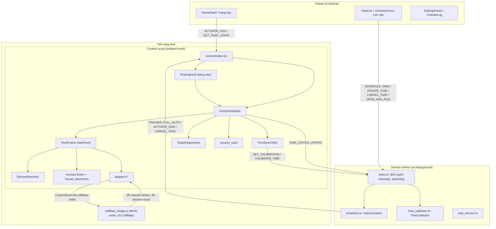
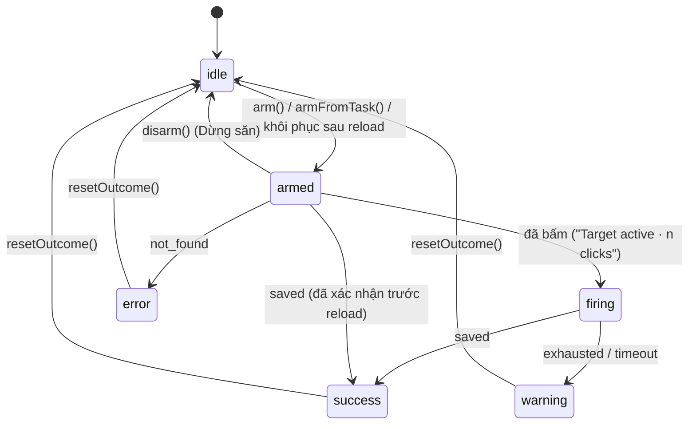

# Kiến trúc DealHunter Extension: bộ săn nút và máy trạng thái

Tài liệu kỹ thuật mô tả kiến trúc, luồng xử lý và các thông số thời gian của Chrome Extension DealHunter (Manifest V3), khớp với mã nguồn trong [`extension/src`](../../extension/src) và [`extension/public`](../../extension/public).

Cập nhật: 2026-10-13 · 33 file test / 317 test (`npx vitest run`).

Tài liệu liên quan: [Hướng dẫn sử dụng](huong-dan-su-dung.md) · [Kết nối web và extension](ket-noi-web-extension.md) · [Rà soát lỗi và kế hoạch sửa](ra-soat-loi-va-ke-hoach-sua.md).

---

## Mục lục

1. [Nguyên tắc sản phẩm](#1-nguyên-tắc-sản-phẩm)
2. [Tổng quan thành phần](#2-tổng-quan-thành-phần)
3. [Trách nhiệm từng phần: popup, bảng săn, content script, background](#3-trách-nhiệm-từng-phần)
4. [Máy trạng thái của một lượt săn và mốc thời gian](#4-máy-trạng-thái-của-một-lượt-săn-và-mốc-thời-gian)
5. [Tìm lại nút và chữ ký nội dung](#5-tìm-lại-nút-và-chữ-ký-nội-dung)
6. [Quy tắc xác nhận hoàn tất](#6-quy-tắc-xác-nhận-hoàn-tất)
7. [An toàn khi bấm](#7-an-toàn-khi-bấm)
8. [Chiến lược tải lại trang](#8-chiến-lược-tải-lại-trang)
9. [Vòng đời lịch săn (background)](#9-vòng-đời-lịch-săn-background)
10. [Canh giờ theo máy chủ của trang](#10-canh-giờ-theo-máy-chủ-của-trang)
11. [Caffiliate: điểm danh theo kế hoạch](#11-caffiliate-điểm-danh-theo-kế-hoạch)
12. [Khóa lưu trữ](#12-khóa-lưu-trữ)
13. [Danh sách message](#13-danh-sách-message)
14. [Bản dev và bản production](#14-bản-dev-và-bản-production)
15. [Cô lập CSS](#15-cô-lập-css)
16. [Kiểm thử](#16-kiểm-thử)

---

## 1. Nguyên tắc sản phẩm

- **Người dùng không phải dân kỹ thuật.** Giao diện không có nút chỉnh thông số kỹ thuật; mọi thời gian (độ lệch đồng hồ, lúc tải lại trang, lịch các lần thử) đều được đo và tính tự động. Người dùng chỉ thấy công tắc bật/tắt và lời lẽ tiếng Việt đơn giản.
- **Quyết định 1: chỉ bấm đúng nút người dùng đã chọn.** "Gợi ý giúp tôi" chỉ tô viền cam một nút (`dh-target-suggest`), người dùng phải xác nhận. Engine không bao giờ tự chuyển sang nút khác khi không tìm thấy nút đã chọn.
- **Quyết định 2: chỉ đo giờ cho trang đang săn** (bảng săn đang mở, lượt săn đang chạy, lịch săn) hoặc khi người dùng yêu cầu; không bao giờ đo trên trang bình thường. Dữ liệu đo theo từng tên miền bị xóa sau 24 giờ.
- **Quyết định 3:** giữ quyền `<all_urls>` nhưng bảng săn chỉ tự mở trên trang voucher/deal của sàn (Shopee, Lazada, Tiki, TikTok, Sendo, AliExpress, Taobao, so theo host thật); huy hiệu giá chỉ hiện trên trang sản phẩm của sàn; không có `web_accessible_resources`; không xin quyền `tabs`.

Quyền trong [`public/manifest.json`](../../extension/public/manifest.json): `storage`, `alarms`, `scripting`; `host_permissions: ["<all_urls>"]`.

---

## 2. Tổng quan thành phần



| Thành phần | File | Vai trò |
| :--- | :--- | :--- |
| `HuntCoordinator` | [`content/core/hunt_coordinator.ts`](../../extension/src/content/core/hunt_coordinator.ts) | Nguồn sự thật duy nhất của lượt săn trên tab: chỉ một engine chạy tại một thời điểm; nhận lượt săn từ bảng săn (`arm`) và từ lịch (`armFromTask`); lưu và khôi phục phiên qua reload; báo kết quả về background. |
| `HuntEngine` | [`content/core/hunt_engine.ts`](../../extension/src/content/core/hunt_engine.ts) | Vòng lặp nhịp 10 ms (`WorkerTimer`): chờ tới giờ, tìm lại nút, bấm, xác nhận hoàn tất, tải lại trang khi cần. |
| `ElementResolver` | [`content/core/element_resolver.ts`](../../extension/src/content/core/element_resolver.ts) | Mô tả nút đã chọn (`describeUniversal`), tìm lại nút (`relocateUniversal`), đọc trạng thái nút (`getButtonState`) và xác nhận hoàn tất (`isTargetCompleted`). |
| `HumanClicker` | [`content/core/human_clicker.ts`](../../extension/src/content/core/human_clicker.ts), [`human_biometrics.ts`](../../extension/src/content/core/human_biometrics.ts) | Phát chuỗi sự kiện Pointer/Mouse, tọa độ Gauss quanh tâm nút, nhịp bấm theo hồ sơ, kiểm tra nút có bấm được không. |
| `TargetDiagnostics` | [`content/core/target_diagnostics.ts`](../../extension/src/content/core/target_diagnostics.ts) | Phân loại trang: framework, có đồng hồ đếm ngược không, chiến lược tải lại, nhóm nền tảng (`major_marketplace` / `speed_priority`). |
| `TimeSyncClient` | [`content/core/time_sync_client.ts`](../../extension/src/content/core/time_sync_client.ts) | Giờ máy chủ của trang (`Date.now() + offsetMs`), RTT, sai số; xin background đo khi cần. |
| `session_vault` | [`content/core/session_vault.ts`](../../extension/src/content/core/session_vault.ts) | Bản sao phiên săn trong `chrome.storage.local`, trang web không đọc/sửa được. |
| `WorkerTimer` | [`content/core/timer_worker.ts`](../../extension/src/content/core/timer_worker.ts) | Nhịp 10 ms từ Web Worker (Blob URL), không bị Chrome hãm khi tab chạy nền; CSP chặn Worker thì dùng `setInterval`. |
| Adapters | [`content/adapters/`](../../extension/src/content/adapters) | Shopee, Lazada, Tiki, TikTok, Caffiliate; `getAdapterForUrl(url)` chọn theo host. Chỉ Caffiliate có hành vi riêng khi săn. |
| `TaskScheduler` | [`background/scheduler.ts`](../../extension/src/background/scheduler.ts) | Lịch săn: tạo/sửa/xóa, `chrome.alarms`, mở/focus tab, chuyển ngày cho lịch hằng ngày, watchdog. |
| `TimeCalibrator` | [`background/time_calibrator.ts`](../../extension/src/background/time_calibrator.ts) | Đo độ lệch đồng hồ bằng các yêu cầu `HEAD` tới đúng trang đang săn. |

---

## 3. Trách nhiệm từng phần

### 3.1. Popup ([`src/popup`](../../extension/src/popup))

- Hai tab: **"Trang này"** (`HomePanel`) và **"Lịch săn (n)"** (`TaskList` + `ScheduleForm`), nút bánh răng mở `SettingsPanel`.
- `HomePanel` hỏi tab đang mở bằng `GET_HUNT_STATE` để biết có lượt săn đang chạy (lượt săn bắt đầu từ bảng săn không có task). Nút "Chọn nút" / "Mở bảng săn" gọi `openHuntPanel` ([`page_actions.ts`](../../extension/src/popup/page_actions.ts)): gửi `ACTIVATE_HUD {pickTarget}`; tab mở trước khi cài/cập nhật extension chưa có content script thì chèn `content.css` rồi `content.js` bằng `chrome.scripting` trước.
- Dòng trạng thái đồng hồ (`ClockStatus` trong [`TimeOffsetCard.tsx`](../../extension/src/popup/components/TimeOffsetCard.tsx)) chỉ hiện với trang đang săn (có nút đã lưu hoặc task `pending`/`running`); tự đo lại khi chưa đo, đo hỏng hoặc kết quả cũ hơn 5 phút.
- Form lịch săn là bottom sheet, nút submit dính đáy (sticky). Nút đang chọn hiện thành một thẻ, "Đổi" chuyển sheet sang trang "Chọn nút cần săn": nút đã lưu (theo trang) + "Hoặc thêm nút mới" (trang đang mở khi chưa có nút lưu, hoặc dán link trang khác → `OPEN_AND_PICK`; chưa có nút nào thì sheet mở thẳng trang này). "Chọn lại trên trang" (`OPEN_AND_PICK`), giờ HH:mm:ss (nhanh: 00:00, 12:00, 20:00), "Lặp lại mỗi ngày", "Tải lại trang trước giờ". Popup chỉ gửi message qua [`lib/scheduler_client.ts`](../../extension/src/lib/scheduler_client.ts); danh sách task do background ghi.
- Cài đặt: ngôn ngữ, tài khoản DealHunter, "Nhật ký điểm danh" (Caffiliate), "Dữ liệu trên máy này" (xóa `dh_clock_calibration`, `dh_domain_calibrations`, `dh_page_load_samples`; không đụng task và nút đã lưu), phiên bản ("(bản dev)" ở bản dev).

### 3.2. Bảng săn trên trang ([`content/ui/FloatingHUD.tsx`](../../extension/src/content/ui/FloatingHUD.tsx))

- Gắn vào `#dealhunter-hud-root`, mặc định góc dưới phải. Kéo bằng header hoặc bằng viên thuốc (dạng thu nhỏ; nhả mà không kéo thì mở lại). Khi thả, vị trí được neo vào **góc màn hình gần nhất** + khoảng cách (`ui/hud_position.ts`, lưu `dh_hud_anchor`), nên thu nhỏ / mở ra / đổi cỡ cửa sổ đều giữ đúng góc; nếu tràn màn hình thì được kéo vào (`clampAnchor`, theo `ResizeObserver`). Chiều cao không đổi khi dùng: thông báo nằm trong ô cố định 2 dòng; "Tuỳ chọn thêm" là panel nổi (bấm ra ngoài thì đóng; sự kiện giả `isTrusted === false` bị bỏ qua để "Bấm thử" không đóng panel).
- Bước 1, chọn nút: chế độ chọn (viền khi rê chuột, bấm để chọn, Esc hoặc chuột phải để thôi) hoặc "Gợi ý giúp tôi" (lấy từ `adapter.findVoucherButtons()` hoặc `elementResolver.findCollectButtons()`). Nút đã chọn được lưu tự động cho trang (`savePageTarget`) kèm descriptor và kết quả `targetDiagnostics.analyze()`.
- Bước 2, giờ săn: 0:00 (mặc định), giờ khác HH:mm:ss, "Thử sau 10 giây" (`now + 10 000 ms`). Giờ hiểu theo giờ Việt Nam (GMT+7, [`lib/drop_time.ts`](../../extension/src/lib/drop_time.ts)) bất kể múi giờ máy tính.
- Bước 3: "Bắt đầu săn" gọi `huntCoordinator.arm()`; "Hẹn giờ" gửi `SCHEDULE_TASK` (task `full_auto`, `preWarmSeconds: 60`, `dualDefenseReload` theo công tắc). Trước khi săn, `detectPlatformBlock()` ([`content/platform_block.ts`](../../extension/src/content/platform_block.ts)) chặn nếu tab đang ở trang đăng nhập/xác minh của sàn.
- "Tuỳ chọn thêm": công tắc "Tải lại trang trước giờ" (thời điểm do `reloadTiming` tính, hiện "~x giây"), "Bấm thử" (một lần `humanClicker.dispatchClick` thật lên nút đã chọn), "Quên nút".
- Khi trang có Turnstile tương tác (iframe `challenges.cloudflare.com`), adapter Caffiliate thay dòng trạng thái bằng lời nhắc người dùng tự tick ô.

### 3.3. Content script ([`content/index.tsx`](../../extension/src/content/index.tsx))

- Chạy ở `document_end`, chỉ ở khung trên cùng và không chạy trên SVG/XML/PDF (`exclude_matches` trong manifest + `isTopWindow()`).
- Mỗi lần nạp tạo `INSTANCE_ID`; `removeStaleRoots()` gỡ bảng săn/huy hiệu do bản content script cũ để lại (đánh dấu `data-dh-instance`) sau khi extension được tải lại.
- Ngược lại, chính bản cũ (tab mở sẵn khi extension được tải lại, mọi lệnh `chrome.*` ném "Extension context invalidated") tự phát hiện qua `isExtensionAlive()` (`lib/extension_context.ts`, kiểm mỗi 2 s và khi focus/đổi tab) rồi `retireOrphanedInstance()`: gỡ bảng săn, huy hiệu, picker, viền nút và `huntCoordinator.retire()` dừng lượt săn **không** xoá phiên trong vault và không báo kết quả, để bản mới (tải lại trang hoặc popup mở lại bảng) tiếp tục đúng lượt săn đó. Tin nhắn gửi background từ content đi qua `notifyBackground()` (không bao giờ ném lỗi đồng bộ).
- Tự mở bảng săn khi: trang voucher/deal của sàn (`isECommerceVoucherOrDealPage`), trang có nút đã lưu, có task chưa xong, hoặc có phiên săn đang chạy. Huy hiệu giá (`PriceHistoryBadge`) chỉ trên trang sản phẩm của sàn (`isECommerceProductPage`).
- Khi nạp trang: tìm task chưa xong của trang có giờ săn trong khoảng `[T − 60 s, T + 15 s]` để chạy (`executeFullAutoTask`); nếu không có thì khôi phục phiên săn thủ công (`checkAndResumeArmedSession`). Đồng thời đo thời gian trang sẵn sàng cho `reloadTiming` (mục 8.1).
- Đồng hồ không được đo khi nạp trang; chỉ bảng săn, lượt săn hoặc lịch săn mới gọi `timeSyncClient.init()`.

### 3.4. Background ([`background/index.ts`](../../extension/src/background/index.ts))

- Bỏ qua message có `sender.id` khác extension. Kiểm tra URL bằng `isValidHttpUrl` (chỉ `http:`/`https:`) cho `CALIBRATE_TIME`, `SCHEDULE_TASK`, `UPDATE_TASK`, `OPEN_AND_PICK`.
- Chỉ background ghi danh sách task, qua hàng đợi đọc-sửa-ghi `storage.mutateTasks`; content script báo kết quả bằng `TASK_STATUS_UPDATE`.
- Nhận phiên đăng nhập từ web DealHunter qua `onMessageExternal` (chi tiết: [ket-noi-web-extension.md](ket-noi-web-extension.md)); token nằm trong `chrome.storage.session`. `GET_PRICE_CONTEXT` chỉ gọi API cho URL của sàn được theo dõi giá (`isPriceContextUrl`).

---

## 4. Máy trạng thái của một lượt săn và mốc thời gian

### 4.1. Trạng thái của coordinator và kết quả của engine



`HuntResult` của engine: `saved`, `exhausted`, `not_found` (không có nút / không bấm được lần nào), `timeout` (đã bấm nhưng trang không xác nhận), `cancelled`. Ánh xạ sang trạng thái task: `saved → completed`, `cancelled → cancelled`, còn lại `→ failed`.

Những điều kiện kết thúc khác:
- Không có nút đã chọn (`locked`/`universalDescriptor`) → `not_found` ngay ("No target locked"): từ khóa đơn thuần không phải là mục tiêu.
- URL của tab đổi sang trang khác (`isSamePageUrl` sai) → `cancelled`.
- Lỗi bất ngờ trong một nhịp → `not_found` kèm thông báo lỗi.
- Sau `T + 2 s` mà chưa bấm lần nào, nếu nút đã ở trạng thái `exhausted` hoặc `saved` → kết thúc với trạng thái đó.

### 4.2. Tham số theo nhóm nền tảng

`isMajorMarketplace()` coi Shopee, Lazada, Tiki, TikTok là `major_marketplace`; mọi trang khác là `speed_priority`.

| Tham số | `major_marketplace` | `speed_priority` (trang thường) | Caffiliate |
| :--- | :--- | :--- | :--- |
| Hồ sơ nhịp bấm | `adaptive` | `hyper` | `hyper` (chỉ 1 lần kích hoạt) |
| Bấm sớm trước T (`preFireLeadMs`) | 0 ms | `clamp(round(RTT/2), 28, 180)` ms; 28 ms khi chưa đo RTT hoặc trên localhost | `leadMs` của kế hoạch (≤ 3 000 ms) |
| Số lần bấm tối đa | không giới hạn | 6 | 1 (adapter) |
| Cửa sổ sau T (`windowMs`) | 8 000 ms | 2 000 ms | 8 000 ms (adapter) |
| Cửa sổ khi đã reload cho mốc này | ≥ 10 000 ms | ≥ 2 500 ms | (không reload) |
| HEAD giữ kết nối ở T − 5 s | không | có | có |
| Tải lại trang | theo mục 8 | theo mục 8 | tắt (`shouldDisableReload`) |

Khi engine khởi động sau mốc bấm (ví dụ trang vừa reload), cửa sổ được nới thành ít nhất `thời gian đã trôi qua kể từ T + 2 000 ms` (`speed_priority`) hoặc `+ 8 000 ms` (`major_marketplace`).

Hồ sơ `adaptive` ([`human_biometrics.ts`](../../extension/src/content/core/human_biometrics.ts), `computeAdaptiveInterval`), khoảng cách tới lần bấm kế tiếp lấy mẫu Gauss (Box-Muller) rồi kẹp:

| Pha | Lần bấm | Khoảng cách | Nghỉ ngắn |
| :--- | :--- | :--- | :--- |
| Tăng tốc | 1–3 | N(60, 10) kẹp [42, 80] ms | không |
| Giãn nhịp | 4–8 | N(95, 16) kẹp [70, 130] ms | lần 4: thêm N(50, 12) kẹp [35, 75] ms |
| Ổn định | 9+ | N(140, 22) kẹp [100, 190] ms | mỗi lần thứ 5: thêm N(65, 15) kẹp [40, 100] ms |

Hồ sơ `hyper`: N(25, 4) kẹp [18, 40] ms, nghỉ N(20, 5) sau mỗi 12 lần. (Còn có `stealth`, `pro_gamer`, `turbo` trong `CLICK_PROFILES` nhưng giao diện không cho chọn.)

### 4.3. Dòng thời gian: trang thường (một nhịp 10 ms của engine)

T là giờ săn theo đồng hồ máy chủ của trang (`timeSyncClient.getServerTime()`).

| Mốc | Việc engine làm | Ghi chú |
| :--- | :--- | :--- |
| T − 60 s (lịch săn) | Alarm của task kêu: background đo giờ, mở/focus tab (reload nếu tab đã mở và còn ≥ 20 s), gửi `TRIGGER_FULL_AUTO`. | Mục 9.3 |
| < T − 60 s → | Chờ; trong 60 s cuối: tìm lại nút mỗi nhịp và cuộn nút vào giữa màn hình một lần. | Không thấy nút mà descriptor có `documentTop`: cuộn tới vùng đó để trang nạp lười. |
| T − 5 s … T − 1 s | `speed_priority`: một `fetch(location.href, {method: "HEAD", cache: "no-store", keepalive: true})` để làm nóng kết nối. | |
| T − 3.5 s … T − 0.5 s | Gọi `adapter.preWarmStrike()` (nếu có) rồi tính lại kế hoạch của adapter. | Chỉ Caffiliate có hook này. |
| T − lead … T − max(200, lead − 400) ms | Tải lại trước giờ nếu được bật và nút còn trạng thái hôm qua. | lead đo theo trang (mục 8.1), mặc định 750 ms. |
| T − 800 ms → | `humanClicker.preWarmStrike(el)`: tính sẵn tọa độ và tạo sẵn 7 sự kiện. | |
| T − max(150, preFire + 40) ms | Hết pha chờ, bắt đầu kiểm tra mốc bấm mỗi nhịp. | `leadMs = 150` |
| T − preFire − 35 ms | Bỏ nhịp 10 ms, chờ bằng `requestAnimationFrame` (tab hiện) / `setTimeout(1)`, 6 ms cuối bằng microtask, để bấm sát mốc. | Chỉ khi dùng `WorkerTimer` mặc định. |
| T − preFire | **Mốc bấm.** Nút đã chọn đang `disabled` / `aria-disabled="true"` / class `disabled` thì engine gỡ ra (ghi nhớ `unblockedByUs`), chụp nhãn nút và các thông báo đang có, rồi bấm lần đầu bằng chuỗi sự kiện tạo sẵn. | `major_marketplace`: preFire = 0, nên mốc bấm là T. |
| (T − preFire, T) | Không bấm thêm: trước T chỉ được một lần bấm. | |
| T … T + 2.5 s | Tải lại có kiểm soát khi nút không bấm được hoặc lần bấm "chết". | Mục 8.2 |
| Sau T | Bấm tiếp theo nhịp của hồ sơ cho tới `maxClicks`; tạm dừng khi có tín hiệu hoàn tất đang chờ ổn định. | Mục 6 |
| T + windowMs | Hết cửa sổ: `not_found` (chưa bấm) hoặc `timeout` (đã bấm, không xác nhận). | |

### 4.4. Dòng thời gian: Caffiliate

Chi tiết thuật toán ở mục 11.

| Mốc | Việc xảy ra |
| :--- | :--- |
| Khi nạp trang | `caffiliateAdapter.listenForTimings()`: nghe kết quả từ bridge, đọc lịch sử nhật ký để lấy mẫu thời gian chuẩn bị. Bridge (MAIN world, `document_start`) đã bọc `fetch`, `XMLHttpRequest` và `CheckInTurnstile.getToken` để đo. |
| T − 5 s | HEAD giữ kết nối (như `speed_priority`). |
| T − 3.5 s | `preWarmStrike()`: xóa kết quả lần trước, tính lại kế hoạch (`planStrike`), thêm `<link rel="preconnect" href="https://challenges.cloudflare.com">`. Không lấy trước token Turnstile. |
| T − leadMs (≤ 3 s) | Engine tới mốc bấm, gọi `executeDirectStrike()`: phát `dh-caffiliate-strike` kèm `offsetsMs` và tóm tắt kế hoạch. Việc này tính là lần bấm duy nhất (`maxClicks = 1`); không tải lại trang. |
| T − leadMs + offset_i | Bridge chạy lần thử thứ i (≥ 5 lần): hàm của trang → API → bấm nút. |
| Mỗi 10 ms | Bridge kiểm tra xác nhận; xác nhận xong thì hủy các lần chưa chạy và báo `dh-checkin-result {ok: true}`. Engine thấy `confirmsCompletion` → `saved` ngay. |
| startAt + 8 s / T + 8 s | Bridge: "not confirmed by the page"; engine hết cửa sổ → `timeout`. |

---

## 5. Tìm lại nút và chữ ký nội dung

React/Vue có thể thay node của nút khi đếm ngược kết thúc, nên engine tìm lại nút mỗi nhịp. Nút đang giữ vẫn được dùng nếu còn trong DOM; trước lần bấm đầu, nó phải còn khớp chữ ký nội dung, nếu không thì tìm lại. Sau khi đã bấm, cùng node đổi nhãn ("Điểm danh" → "Đã điểm danh") là câu trả lời đang chờ, không phải nút khác.

### 5.1. Descriptor (`describeUniversal`)

`UniversalTargetDescriptor` gồm: `id`, `uniqueSelector`, `tagName`, các thuộc tính (`data-testid`, `data-test-id`, `name`, `role`, `type`, `aria-label`, `class`, `title`), `initialText` (nhãn nút), `childIndex`, `parentSelector`, `rect`, `documentTop`, `containerText` (chữ của thẻ voucher trừ nhãn nút) và `valueTokens` (số tiền, %, ngày... trích từ `containerText`, bỏ giờ dạng `hh:mm(:ss)`).

### 5.2. Chữ ký nội dung (`matchesContentSignature`)

- **Có thẻ voucher:** các value token phải khớp (`matchesTokens`: trùng hết, chứa đủ, hoặc trùng ≥ 60% và ≥ 2 token), rồi tỷ lệ từ của thẻ trùng phải ≥ 40% khi có token, ≥ 60% khi không có token. Nhãn nút được phép đổi (đếm ngược → "Lưu").
- **Không có thẻ:** so nhãn nút sau khi bỏ giờ, số, khoảng trắng và dấu câu (`labelKey`); nút chỉ có icon thì so `aria-label`, `title`, `class`.

### 5.3. Thứ tự tìm lại (`relocateUniversal`)

1. `id` duy nhất trong trang → tin ngay (kể cả khi chữ đã đổi, ví dụ "Đã điểm danh #3" hôm qua, "Điểm danh" hôm nay); `id` trùng thì phải khớp chữ ký.
2. Gom mọi phần tử cùng `tagName` khớp chữ ký nội dung (bỏ qua UI của DealHunter). Có 0 hoặc 1 thì trả về luôn.
3. Nhiều phần tử: xếp theo độ giống (Jaccard từ của thẻ + 0.5 nếu cùng nhãn); lấy phần tử điểm cao nhất nếu duy nhất.
4. Còn hòa: gợi ý cấu trúc (`uniqueSelector`, `data-testid`, `data-test-id`, `name`, `aria-label`) chỉ đúng một phần tử thì lấy.
5. Cuối cùng: vị trí, chỉ khi rõ ràng (gần nhất ≤ 40 px và phần tử kế tiếp ≥ 120 px). Nếu không thì **không trả về gì**: thà không bấm còn hơn bấm nhầm.

Cấu trúc (selector, đường DOM, vị trí) chỉ dùng để phá hòa, không bao giờ đứng một mình.

---

## 6. Quy tắc xác nhận hoàn tất

Engine chỉ xét hoàn tất khi **đã bấm ít nhất một lần** cho mốc này (hoặc đã bấm trước một lần reload, khóa `dh_clicked_<T>`): nhãn "đã lưu" của hôm qua không phải thành công của hôm nay.

### 6.1. Tín hiệu (`isTargetCompleted`)

- Nút không còn trong DOM **không** phải bằng chứng thành công (có thể là chuyển trang, captcha, re-render).
- Nút đang tải (`aria-busy="true"`, class `loading`/`spinner`/`busy`) → chưa xong.
- Sau khi bấm, một trong các thay đổi sau:
  - nút chuyển sang `disabled` (bỏ qua nếu chính engine đã gỡ `disabled` trước đó: trang chỉ khóa lại như cũ);
  - nhãn đổi so với nhãn chụp ngay trước lần bấm đầu (bỏ phần giờ);
  - xuất hiện icon hoàn tất trong nút (`check`, `tick`, `success`, `done`...);
  - nút có class hoàn tất (`completed`, `success`, `is-saved`, `claimed`, `done`, `checked`...).
  Nếu lúc đó `getButtonState` là `exhausted` thì kết quả là `exhausted`, ngược lại `saved`.
- Thẻ voucher có icon hoàn tất hoặc chuyển sang `saved`/`exhausted`.
- Thông báo của trang (`checkPageToastConfirmation`): `[role=alert|status|dialog|alertdialog]`, `aria-live`, toast của Shopee/Lazada/TikTok/Tiki/Ant Design/SweetAlert và các lớp chung (`toast`, `snackbar`, `notification`, `popup`...). Thông báo phải hiện thấy, không nằm trong UI DealHunter và **không có sẵn từ trước lần bấm đầu** (`snapshotToasts`, so cả nội dung). Lỗi/cảnh báo (icon, `data-type`, class, màu đỏ/cam) → `exhausted`; thành công (icon, `data-type`, class, màu xanh) → `saved`. Vùng live chỉ có chữ thì không tính.
- Trạng thái tĩnh của nút: ARIA (`aria-pressed|checked|selected="true"`), `data-state`/`data-status` hoàn tất, class hết hàng, thanh tiến độ 100% hoặc `data-stock="0"`.

### 6.2. Thời gian giữ ổn định (`settle`)

- Một tín hiệu phải giữ nguyên **300 ms** mới được tính (`CONFIRM_STABLE_MS`).
- Nếu tín hiệu duy nhất là nút chuyển `disabled` (`weak`), phải giữ **1 500 ms** (`CONFIRM_WEAK_MS`): nút cũng bị khóa trong lúc request đang chạy.
- Trong lúc tín hiệu đang chờ ổn định, engine **không bấm thêm** (một lần bấm nữa có thể hủy việc lưu).
- Chỉ adapter biết chắc kết quả (`confirmsCompletion`, hiện chỉ Caffiliate) mới kết thúc ngay không cần chờ.

---

## 7. An toàn khi bấm

- **Chỉ nút đã chọn.** Không tìm thấy nút đã chọn thì không bấm gì (mục 5.3). "Bấm thử" cũng chỉ bấm nút đã chọn.
- **Không bấm lần đầu vào nút hết hàng** (`state === "exhausted"`). Nút còn nhãn `saved` của hôm qua chỉ được bấm xuyên qua ở lần đầu, trừ khi đã bấm mốc này trước một lần reload.
- **Trước T chỉ một lần bấm** (lần bấm sớm bù độ trễ mạng); các sàn lớn có `preFireLeadMs = 0` nên không bao giờ bấm trước T.
- **Nút phải bấm được thật:** mọi đường bấm (`dispatchClick`, `dispatchPreWarmedStrike`, `dispatchClickAsync`) đều kiểm tra kích thước khác 0 và `document.elementFromPoint` tại tọa độ bấm phải là nút (hoặc con/cha của nó). Bị modal, captcha, banner cookie che thì không bấm; chỉ UI của DealHunter được miễn. Nút ngoài màn hình thì cuộn vào trước khi bấm.
- **Gợi ý tự động loại nút nguy hiểm:** `allVoucherButtons` bỏ qua nút mở dialog/accordion, liên kết điều hướng, nút phụ (`secondary`, `detail`, `terms`, `close`...), và nút mua/thanh toán theo class (`checkout`, `buy-now`, `payment`, `pay`...) hoặc theo nhãn bắt đầu bằng "Mua ngay", "Mua với voucher", "Thanh toán", "Đặt hàng", "Buy now"... (kể cả "Mua ngay -50%").
- **Chuỗi sự kiện:** `pointerover → pointerenter → pointerdown → mousedown → focus → pointerup → mouseup → click`, `pointerId: 1`, `pointerType: "mouse"`, `isPrimary: true`, `pressure` 0.5 khi nhấn, `buttons` 1/0, `bubbles/cancelable/composed: true`. Tọa độ Gauss N(0.5, 0.1) theo chiều rộng/cao của nút, kẹp [0.25, 0.75]. Engine phát chuỗi này đồng bộ; quỹ đạo Bezier (`simulateApproach`) chỉ dùng cho "Bấm thử" và khi lần bấm đầu trên sàn lớn không có chuỗi tạo sẵn.

---

## 8. Chiến lược tải lại trang

### 8.1. Khi nào được tải lại

- Adapter tắt reload (Caffiliate) → không bao giờ.
- `TargetDiagnostics.inspect()` thấy trang là `reactive_no_reload` (nhận ra React/Vue/Angular/Svelte, hoặc có đồng hồ đếm ngược quanh nút) → không reload, dù công tắc đang bật: trang tự cập nhật nút.
- Trang tĩnh (`static_dual_defense`) → theo công tắc "Tải lại trang trước giờ" (mặc định bật); không có kết quả chẩn đoán thì theo công tắc.

Phiên lưu cả giá trị hiệu lực (`dualDefenseReload`) và công tắc người dùng (`reloadSwitch`) để bảng săn hiển thị lại đúng sau reload.

**Thời điểm tải lại trước giờ được đo, không cố định** ([`lib/reload_timing.ts`](../../extension/src/lib/reload_timing.ts)):

```
lead = median(thời gian sẵn sàng) + 1.5 × spread + 150 ms,   kẹp trong [400 ms, 6 000 ms]
spread = IQR / 1.349 khi có ≥ 4 mẫu, ngược lại median / 4
chưa có mẫu: 750 ms
```

Mẫu = thời gian từ lúc bắt đầu điều hướng tới khi `relocateUniversal` tìm thấy nút, đo trên trang có nút đã lưu hoặc phiên săn đang chạy; chỉ khi tab đang hiện, không phải từ bộ nhớ back/forward, tối đa 15 s (hỏi lại mỗi 50 ms). Lưu theo trang (origin + path), giữ 10 mẫu mới nhất, quên trang không ghé sau 30 ngày.

### 8.2. Các lần tải lại trong một mốc

Bộ đếm `dh_reload_count_<T>` trong `sessionStorage` dùng chung cho cả hai loại, nên **tối đa 3 lần reload cho mỗi mốc**, kể cả lần trước giờ.

1. **Trước giờ:** khi `T − lead ≤ now ≤ T − max(200, lead − 400)`, chưa bấm, chưa reload lần nào và nút còn trạng thái hôm qua (`disabled` hoặc `saved`) → reload (bộ đếm = 1).
2. **Trong `[T, T + 2.5 s]`**, khi bộ đếm < 3 và đã cách lần reload trước ≥ 450 ms:
   - chưa bấm lần nào và nút không có, không bấm được, hoặc vẫn `saved`; hoặc
   - **lần bấm "chết"**: đã bấm, nút đã bị khóa từ lúc nạp, không có tín hiệu hoàn tất đang chờ, và đã ≥ **600 ms** (`DEAD_CLICK_MS`) từ lần bấm cuối mà không có phản hồi. Chờ 600 ms để request kịp trả về; reload sớm hơn sẽ hủy nó.

Sau một lần reload mà trước đó đã bấm (`dh_clicked_<T> = "1"`), trạng thái `saved` trên trang được coi là kết quả của chính lượt săn. Khi lượt săn kết thúc, engine xóa `dh_reload_count_<T>`, `dh_last_reload_time_<T>`, `dh_clicked_<T>`.

### 8.3. Giữ phiên qua reload

- `HuntCoordinator.persistSession()` ghi phiên vào vault `chrome.storage.local["dh_armed_sessions"]` theo token ngẫu nhiên (`crypto.randomUUID()`); `sessionStorage["dh_armed_session"]` chỉ dùng để mang token (kèm bản sao để hiển thị). Ghi vault qua hàng đợi; mục cũ hơn 24 giờ bị xóa.
- Khi nạp lại, `checkAndResumeArmedSession()` lấy token từ `sessionStorage` nhưng **chỉ nạp phiên từ vault**, nên trang không thể giả hoặc sửa một lượt săn. Phiên bị bỏ nếu khác trang hoặc đã quá `T + 15 s`.
- Task lịch săn thì được nạp lại từ danh sách task (mục 3.3), không qua vault.

---

## 9. Vòng đời lịch săn (background)

### 9.1. Dữ liệu và trạng thái task

`ScheduledTask` lưu giờ dạng `targetHour/targetMinute/targetSecond` (giờ Việt Nam), `targetUrl`, `isDaily`, `descriptor`, `savedTargetId`, `dualDefenseReload`, `preWarmSeconds` (60), `diagnostics` và `targetAt` (mốc tuyệt đối). Trạng thái: `pending`, `running`, `completed`, `failed`, `cancelled`, `missed`.

- **`targetAt` được khóa** khi tạo task (`nextExactDropAt` từ lúc tạo), không tính lại mỗi lần đọc, để không nhảy sang ngày hôm sau. Task cũ chưa có `targetAt` dùng mốc đầu tiên sau `createdAt`.
- **Alarm** `dh_task_<id>` kêu lúc `targetAt − preWarmSeconds × 1000`, ít nhất 500 ms sau hiện tại.

### 9.2. Tạo, sửa, xóa, chọn lại nút

- `SCHEDULE_TASK` → `scheduleTask`: nếu đã có task `pending` cùng trang (`isSamePageUrl`) và cùng giờ:phút:giây thì **cập nhật task đó** (giữ `id`, `createdAt`) thay vì thêm bản trùng; đặt lại alarm.
- `UPDATE_TASK` → `updateTask`: ghi đè thay đổi, đưa về `pending`, tính lại `targetAt` từ hiện tại, đặt lại alarm.
- `CANCEL_TASK` → `cancelTask`: **xóa** task, xóa alarm, gửi `CANCEL_TASK {taskId}` tới các tab cùng trang; tab chỉ dừng nếu lượt săn đang chạy đúng là của task đó (không đụng lượt săn thủ công hay task khác).
- `OPEN_AND_PICK` → `openAndPick`: tìm tab cùng trang để focus, không có thì mở tab mới; chờ tab `complete` (tối đa 15 s, hỏi mỗi 300 ms); gửi `ACTIVATE_HUD {pickTarget: true}`, nếu lỗi thì chèn `content.css` + `content.js` rồi gửi lại.
- Nút đã lưu của trang luôn thắng bản sao trong task: khi alarm kêu và khi `armFromTask` chạy, descriptor được lấy lại từ `dh_saved_page_targets` (theo `savedTargetId` hoặc theo URL). Chọn lại nút trên trang là đổi nút cho mọi lượt săn của trang đó.

### 9.3. Khi alarm kêu (`handleAlarm`)

1. Bỏ qua nếu task không còn `pending`/`running`.
2. `now > targetAt + 15 s` → báo `missed` ("máy ngủ hoặc tắt").
3. Lấy lại nút đã lưu; nếu task chưa đặt `dualDefenseReload` thì theo nút đã lưu.
4. Đo giờ: `timeCalibrator.calibrate(3, 4000, "<origin>/favicon.ico")` (mục 10).
5. Tìm tab cùng trang: có thì focus tab và cửa sổ; nếu còn ≥ 20 s trước T thì reload tab và chờ `complete` (tối đa 10 s). Không có thì mở tab mới.
6. Đánh dấu task `running`, ghi nhớ tab đang chạy task.
7. Gửi `TRIGGER_FULL_AUTO {task}` (thử lại một lần sau 1 s nếu content script chưa sẵn sàng); tab mới/đang tải thì hỏi trạng thái mỗi 400 ms, tối đa 15 s.

Phía content: `executeFullAutoTask` mở bảng săn, chặn nếu đang ở trang đăng nhập/xác minh (báo `failed`), rồi `armFromTask`: khởi tạo đồng hồ, quá `T + 15 s` thì báo `missed`, ngược lại `arm()`. Nếu đang có lượt săn thủ công không gắn task và lệch ≤ 1 s với task, coordinator **nhận task đó vào lượt săn hiện tại** thay vì hủy và chạy lại.

Ngoài ra:
- Tab đang chạy task tải xong (`tabs.onUpdated` `complete`) trong khoảng `[T − preWarm, T + 10 s]` → gửi lại `TRIGGER_FULL_AUTO`.
- Tab đang chạy task bị đóng khi task còn `running` → `failed` ("Target tab was closed before drop").

### 9.4. Kết quả và chuyển ngày

`TASK_STATUS_UPDATE` → `handleTaskStatusUpdate`. Task hằng ngày gặp bất kỳ kết quả nào trong `completed`, `failed`, `missed`, `cancelled` thì **chuyển sang mốc kế tiếp** (`rollDailyTask`: mốc đầu tiên sau `max(now, targetAt) + 60 s`), về `pending`, giữ `lastResult`, đặt alarm mới. "Dừng săn" trên một lượt săn theo lịch chỉ bỏ lượt hôm nay. Task một lần thì lưu trạng thái và kết quả. Task đã bị xóa thì bỏ qua.

### 9.5. Watchdog và khởi động

Alarm `dh_watchdog` mỗi 5 phút, cộng `onStartup` và `onInstalled`, chạy `restorePendingAlarms()` trong một lần ghi:

- **Gộp bản trùng:** các task `pending` cùng trang (URL chuẩn hóa), cùng giờ:phút:giây và cùng cờ hằng ngày → giữ bản cũ nhất, xóa alarm của bản thừa.
- Task `pending` quá `T + 15 s` hoặc `running` quá `T + 60 s` (kết quả không bao giờ về) → hằng ngày thì chuyển sang mốc kế tiếp, một lần thì `missed`.
- Task `pending` thiếu alarm thì tạo lại; **alarm đang có được giữ nguyên** để task sắp chạy không bị kích hoạt hai lần.

Không đo giờ khi cài đặt hoặc khởi động trình duyệt (quyết định 2).

---

## 10. Canh giờ theo máy chủ của trang

### 10.1. Ai yêu cầu đo

- `timeSyncClient.init()` chỉ được gọi bởi bảng săn, `armFromTask`, và (sau lần gọi đầu) khi tab được focus/hiện lại. Trước lần `init()` đầu tiên, sự kiện focus không làm gì: trang thường không bao giờ bị đo.
- `init()` hỏi `GET_CALIBRATION {domain}`. Có kết quả đúng tên miền, `calibrated` và mới hơn 5 phút thì dùng; ngược lại gửi `CALIBRATE_TIME {samples: 3, targetUrl: "<origin>/favicon.ico"}`. Nút "Thử lại" trên bảng săn gọi `calibrate()` trực tiếp.
- Alarm lịch săn đo bằng `calibrate(3, 4000, ...)`; dòng đồng hồ trong popup gửi `CALIBRATE_TIME` cho trang đang săn.
- Không có trang mặc định để đo: `calibrate()` bắt buộc có URL `http(s)`.

### 10.2. Thuật toán (`TimeCalibrator`)

- Gửi `HEAD` (`cache: "no-store"`, `credentials: "omit"`) liên tiếp, cách nhau 80 ms, tới khi thấy đủ số lần giây máy chủ nhảy (`boundaries`, mặc định 3) hoặc hết thời gian (`budgetMs`: 4 000 ms cho alarm, 6 000 ms qua message).
- Header `Date` chỉ chính xác tới giây, nên chỉ dùng **cặp mẫu liên tiếp mà giây tăng đúng 1**: mốc giây nằm giữa trung điểm hai lần đo, `offset = giây máy chủ − (mid_trước + mid_sau)/2`, sai số = nửa khoảng cách hai trung điểm. Lấy trung vị các ước lượng; RTT là trung vị các vòng.
- **Favicon cũ từ CDN:** nếu `Date` lệch giờ máy hơn 10 phút, hoặc vẫn cùng một giây sau hơn 2 s, thì favicon đang được phục vụ từ cache. Khi đó chuyển (một lần) sang trang chủ của cùng site (`<origin>/`) và đo lại từ đầu. Không bao giờ đo sang site khác.
- 3 lần lỗi liên tiếp thì dừng; sau mỗi lần lỗi chờ 200 ms.
- **Một lần đo cho mỗi host tại một thời điểm** (`inFlight`): các bên gọi cùng lúc (focus tab, popup, alarm) dùng chung một promise.
- Lần đo hỏng (`calibrated: false`) không ghi đè kết quả tốt đã lưu, và tab đã có độ lệch tốt vẫn giữ độ lệch đó (`TimeSyncClient.calibrate`). Chỉ khi chưa từng đo được thì tab dùng giờ máy tính (offset 0) và bảng săn hiện "Dùng giờ máy tính (trang không báo giờ)".

### 10.3. Lưu trữ

`saveCalibration` ghi `dh_clock_calibration` (lần đo gần nhất) và `dh_domain_calibrations[host]` (bỏ `www.`); mỗi lần ghi xóa các host đo đã quá 24 giờ, `getCalibration` cũng không trả kết quả quá 24 giờ. Mọi tab cùng tên miền nhận kết quả mới qua `chrome.storage.onChanged`.

---

## 11. Caffiliate: điểm danh theo kế hoạch

Áp dụng cho `caffiliate.vn` và `*.caffiliate.vn`; bản dev thêm Caffiliate Bench simulator ở `http://localhost:3100` / `http://127.0.0.1:3100`. URL chỉ chứa chữ "caffiliate.vn" ở path/query không khớp.

### 11.1. Cầu nối MAIN world

Content script chạy ở isolated world nên không gọi được hàm của trang. [`public/caffiliate_bridge.js`](../../extension/public/caffiliate_bridge.js) được nạp qua `content_scripts` với `"world": "MAIN"`, `run_at: document_start` (không dùng `web_accessible_resources`). Hai bên trao đổi bằng `CustomEvent` có `detail` là chuỗi JSON:

| Sự kiện | Chiều | Nội dung |
| :--- | :--- | :--- |
| `dh-caffiliate-strike` | content → bridge | `offsetsMs` và tóm tắt kế hoạch (`attempts`, `leadMs`, `prepMs`, `oneWayMs`, `sigmaMs`, `arrivalsMs`). |
| `dh-checkin-timing` | bridge → content | Toàn bộ lần chạy: từng lần thử, các tầng, thời gian Turnstile, lúc gửi, phản hồi. |
| `dh-checkin-result` | bridge → content | `{ ok, method, error }`; chỉ `ok: true` mới đặt `confirmed`. |

Bridge còn đặt `data-dh-turnstile-challenge="active"` trên `<html>` (kiểm tra mỗi 500 ms) khi có iframe Turnstile để bảng săn nhắc người dùng.

### 11.2. Ba tầng của mỗi lần thử

Trước lần thử đầu, bridge đặt lại các cờ còn từ hôm qua (`todayCheckedIn`, `isCheckedIn`, `hasClaimed`) trong `app.state`; trước mỗi lần thử, đặt lại khóa đang chạy (`checkInLocked`, `isCheckingIn`). Máy chủ quyết định có cho điểm danh hay không.

1. **Hàm của trang:** `app.checkIn()`; không có thì hàm đầu tiên có tên khớp `/^(check_?in|claim|diem_?danh|attendance|reward)/i` (tìm cả trên prototype). Trang tự xin token Turnstile và tự gửi request. Chỉ chuyển tầng khi hàm throw hoặc promise bị reject.
2. **API** `POST /api/v2/xeng/check-in-secure`: token mới từ `CheckInTurnstile.getToken()` của trang, chữ ký từ `app.generateSignature(ts, nonce)` của trang, kèm CSRF của trang. Trang không có hàm ký thì bỏ qua tầng này (không tự chế header).
3. **Bấm nút** điểm danh: gỡ `disabled`/`aria-disabled`/`pointer-events-none` rồi `click()`.

Không lấy trước hoặc giữ token Turnstile để dùng sau.

**Xác nhận (phía adapter):** nhãn nút lúc chuẩn bị (T − 3.5 s, nhãn của hôm qua, ví dụ "Đã điểm danh #4") được ghi lại; nhãn "Đã điểm danh #N" chỉ tính là xong khi **khác** nhãn đó, hoặc khi bridge báo `dh-checkin-result ok`. Trước đây nhãn của hôm qua làm engine báo "Thành công" ngay lúc bắn.

**Xác nhận (bridge):** `app.state.todayCheckedIn === true` (sau khi đã đặt lại), nút đổi thành "Đã điểm danh #N" khác với nhãn trước lúc bắt đầu, hoặc API trả thành công. Kiểm tra mỗi 10 ms; xác nhận xong thì hủy các lần chưa chạy; quá 8 s thì kết thúc thất bại. Popup bất kỳ (kể cả popup lỗi "Chưa tới giờ") không được tính là thành công.

### 11.3. Công thức kế hoạch ([`lib/strike_plan.ts`](../../extension/src/lib/strike_plan.ts))

Mục tiêu là request **được máy chủ xử lý** ngay sau 00:00, không phải bắt đầu quanh 00:00. Lần thử bắt đầu lúc $s$ được xử lý khoảng $s + P + L$.

- $P$ (chuẩn bị, chủ yếu là Turnstile): trung vị "bắt đầu lần thử → request rời máy" trong 10 lần chạy gần nhất **của cùng trang** (host) trong nhật ký; lần chạy trên trình mô phỏng không ảnh hưởng trang thật. Mỗi lần chạy chỉ lấy **lần thử có request đi đầu tiên** (lần chờ token); các lần sau dùng chung token đang chờ của trang và đứng sau nó nên không phản ánh thời gian thật. Chỉ tính lần chạy mà tầng đầu là hàm của trang và thành công, hoặc lần bấm tay. Chưa có mẫu: $P = 0$.
- $L$ (từ lúc request rời máy tới lúc máy chủ xử lý): học từ nhật ký, bằng trung vị "request → phản hồi" (chỉ phản hồi 2xx của lần đi đầu) trừ $RTT/2$ (đường về), giới hạn $[RTT/2,\ 1000]$. Máy chủ còn tự hỏi Cloudflare để kiểm token trước khi trả lời, nên $L$ lớn hơn nhiều so với $RTT/2$ (đêm 13/10: 186 ms phản hồi, $L$ = 147 ms so với 39 ms trước đây). Chưa có mẫu: $RTT/2$ (chưa đo: 30 ms).
- Độ không chắc chắn: $\sigma = \max\left(10,\ \sqrt{(E/\sqrt{3})^2 + J_P^2 + J_L^2}
ight)$ với $E$ = sai số canh giờ (giới hạn 1 000 ms), $J_P$ = IQR/1.349 của $P$ (dưới 4 mẫu thì $P/4$), $J_L$ = IQR/1.349 của thời gian phản hồi khi có ≥ 4 mẫu, nếu không thì $L/4$ (chưa đo gì thì $J_L = L$).
- **Chờ token** ($P \ge 300$ ms, `tokenBound`): trang chỉ giải một thử thách Turnstile mỗi lúc, nên giờ tới máy chủ do lần thử đầu quyết định; lần nào tới trước 0h bị từ chối sau khi đã tiêu token và lần kế phải giải thử thách mới (~1 giây). Vì vậy $a_0 = \max(20,\ 1 \cdot \sigma)$ sau 0h (tới sau 0h trong ~84% số đêm), các lần sau là dự phòng $a_i = a_0 + 20i$, $n = 5$. Biên sau 0h tự thu hẹp khi nhật ký có thêm mẫu ổn định.
- **Không chờ token** ($P < 300$ ms): $n = \mathrm{clamp}(\lceil 3\sigma / 20 
ceil + 1,\ 5,\ 8)$ và $a_i = \sigma \cdot (\Phi^{-1}((i + 0.5)/n) + 0.3)$, mỗi lần cách lần trước ít nhất 20 ms: vài lần ngay trước 0h, các lần sau ngay sau 0h.
- Bắt đầu: $s_i = a_i - P - L$. `leadMs` $= \min(3000, -s_0)$; `offsetsMs` $= s_i - s_0$.

Ví dụ đêm 14/10 (dữ liệu đêm 13/10: $P$ = 1571, phản hồi 186 ms, RTT 78): bắt đầu T − 1323 ms (23:59:58.677), dự kiến được xử lý 00:00:00.395 ± 395 ms. Đêm 13/10 (chưa có mẫu): bắt đầu T − 98 ms, tới 00:00:01.477.

Engine nhận `leadMs` qua `planStrike()` (tính lúc khởi động và tính lại ngay sau `preWarmStrike()` ở T − 3.5 s) và dùng nó làm mốc bấm. Bridge đặt hẹn giờ cho mỗi lần thử tính từ lúc bắt đầu chuỗi (hẹn giờ trễ không đẩy lùi các lần sau), lần nào tới sớm thì chờ nốt phần còn lại. Thiếu lịch trong sự kiện thì dùng `[0, 35, 70, 105, 140]` ms.

### 11.4. Nhật ký điểm danh

Mỗi lần chạy (theo kế hoạch hoặc bấm tay) được ghi vào `dh_checkin_logs` (mới nhất trước, giữ 30 mục), thời gian đổi sang giờ máy chủ: kết quả, cách thành công, kế hoạch, và từng lần thử (giờ bắt đầu, các tầng và lỗi, thời gian Turnstile, lúc gửi và sau bao nhiêu ms, thời gian máy chủ trả lời, HTTP, và **câu trả lời của máy chủ** rút gọn). Câu trả lời đọc từ bản sao phản hồi (`resp.clone()`, trang vẫn đọc bản gốc): với JSON chỉ giữ các trường kiểu thông báo (`success`/`ok`/`code`/`status`, `message`/`msg`/`error`/`detail`/`reason`, `rank`), không lưu nguyên body (có thể chứa token); với trang lỗi HTML thì lấy chữ; tối đa 160 ký tự. Nhật ký chờ tối đa 0,5 s để đọc xong câu trả lời, còn kết quả `dh-checkin-result` vẫn gửi ngay. Chỉ request **POST** tới URL điểm danh được gán cho lần thử (theo thứ tự); các request GET trạng thái/bảng vàng trang tự gọi sau khi điểm danh không được tính. Xem trong Cài đặt → "Nhật ký điểm danh" ([`CheckInLog.tsx`](../../extension/src/popup/components/CheckInLog.tsx)).

---

## 12. Khóa lưu trữ

`chrome.storage.local` (khai báo trong [`lib/constants.ts`](../../extension/src/lib/constants.ts)):

| Khóa | Nội dung | Người ghi |
| :--- | :--- | :--- |
| `dh_scheduled_tasks` | Danh sách task | Background (`mutateTasks`) |
| `dh_saved_page_targets` | Nút đã lưu theo trang (descriptor, tên, giờ, công tắc reload) | Bảng săn |
| `dh_clock_calibration` | Lần canh giờ gần nhất | Background |
| `dh_domain_calibrations` | Canh giờ theo host, hết hạn sau 24 giờ | Background |
| `dh_page_load_samples` | Thời gian sẵn sàng theo trang (10 mẫu, 30 ngày) | Content script |
| `dh_armed_sessions` | Vault phiên săn theo token (24 giờ) | Content script |
| `dh_checkin_logs` | Nhật ký điểm danh Caffiliate (30 mục) | Content script |
| `dh_hud_anchor` | Vị trí bảng săn: góc màn hình gần nhất + khoảng cách | Content script (bảng săn) |
| `dh_settings` | Ngôn ngữ và cài đặt khác | Popup |
| `dh_last_web_url` | URL web DealHunter gần nhất | Background |

`chrome.storage.session`: `dh_web_session` (phiên đăng nhập web, mất khi đóng trình duyệt).

`sessionStorage` của trang: `dh_armed_session` (token phiên), `dh_reload_count_<T>`, `dh_last_reload_time_<T>`, `dh_clicked_<T>`. Engine vẫn đọc `dh_emergency_reloaded_<T>` (khóa cũ) nhưng không còn ghi.

Alarm: `dh_task_<id>`, `dh_watchdog`. Dấu trên DOM: `#dealhunter-hud-root`, `#dealhunter-badge-root`, `#dh-picker-overlay`, `data-dh-instance`, `data-dh-turnstile-challenge`, class `dh-target-highlight`, `dh-target-suggest`.

---

## 13. Danh sách message

Gửi tới background (`chrome.runtime.sendMessage`):

| `action` | Từ | Tham số | Xử lý |
| :--- | :--- | :--- | :--- |
| `CALIBRATE_TIME` | content, popup | `samples`, `targetUrl` | `timeCalibrator.calibrate(samples ‖ 5, 6000, targetUrl)` |
| `GET_CALIBRATION` | content | `domain` | Kết quả canh giờ của host (≤ 24 giờ) |
| `TASK_STATUS_UPDATE` | content | `taskId`, `status`, `result` | `handleTaskStatusUpdate` |
| `SCHEDULE_TASK` | HUD, popup | `task` | `scheduleTask` (gộp bản trùng) |
| `UPDATE_TASK` | popup | `task` | `updateTask` |
| `CANCEL_TASK` | popup | `taskId` | Xóa task và báo các tab cùng trang |
| `OPEN_AND_PICK` | popup | `url` | Mở/focus trang và vào chế độ chọn nút |
| `GET_PRICE_CONTEXT` | huy hiệu giá | `url` | Chỉ URL sàn theo dõi giá, chỉ khi đã đăng nhập |
| `GET_WEB_SESSION` | popup | | `{signedIn, email, name}` (không bao giờ trả token) |

Gửi tới content script (`chrome.tabs.sendMessage`):

| `action` | Từ | Tham số | Xử lý |
| :--- | :--- | :--- | :--- |
| `ACTIVATE_HUD` | popup, background | `pickTarget` | Mở bảng săn, tùy chọn vào chế độ chọn nút |
| `TRIGGER_FULL_AUTO` | background | `task` | `executeFullAutoTask(task)` |
| `CANCEL_TASK` | background | `taskId` | Dừng lượt săn nếu đúng là của task đó |
| `GET_HUNT_STATE` | popup | | `{isArmed, targetTimestamp}` |

Từ web DealHunter (`onMessageExternal`): `{ type: "DH_WEB_SESSION", ... }`, trả `{ accepted }`. Chi tiết ở [ket-noi-web-extension.md](ket-noi-web-extension.md).

`START_BURST_CLICK` và `STOP_BURST_CLICK` vẫn có trong `MESSAGE_ACTIONS` nhưng không có bên nào xử lý.

---

## 14. Bản dev và bản production

| | `npm run build` (production) | `npm run build:dev` / `npm run dev` (watch) |
| :--- | :--- | :--- |
| `__DH_DEV__` ([`lib/build_env.ts`](../../extension/src/lib/build_env.ts)) | `false` | `true` (`--mode development` hoặc `DH_ENV=development`) |
| Web được trao phiên đăng nhập (`DEALHUNTER_WEB_ORIGINS`) | `https://dealhunter.io.vn`, `https://www.dealhunter.io.vn` | thêm `http://localhost:3000`, `http://localhost:3100` |
| API mặc định | `https://dealhunter.io.vn/api/v1` | `http://localhost:8080/api/v1` |
| Manifest | [`src/build/manifest_env.ts`](../../extension/src/build/manifest_env.ts) bỏ mọi mẫu localhost khỏi `externally_connectable` và `content_scripts` | giữ nguyên `public/manifest.json` |
| Caffiliate Bench simulator (:3100) | không | có |

Build gồm hai bước Vite: [`vite.config.ts`](../../extension/vite.config.ts) (popup, `background.js`, chép `public/` và chỉnh manifest theo môi trường) và [`vite.content.config.ts`](../../extension/vite.content.config.ts) (`content.js` dạng IIFE, `content.css`, `publicDir: false` để không ghi đè manifest đã chỉnh).

Nạp vào Chrome: `chrome://extensions` → bật Developer mode → Load unpacked → chọn `extension/dist`; tải lại extension sau mỗi lần build.

---

## 15. Cô lập CSS

`content.css` được chèn vào mọi trang có bảng săn hoặc huy hiệu giá, nên không được ảnh hưởng tới trang ([`tailwind.content.config.js`](../../extension/tailwind.content.config.js)):

- `important: ":is(#dealhunter-hud-root, #dealhunter-badge-root, .dh-root)"`: utility chỉ áp dụng bên trong container của DealHunter (không bao giờ dùng `#root`, nơi gắn của đa số app React).
- `content` chỉ quét `src/content/**`; tắt `preflight` và `container`.
- Keyframes đổi tên `dh-spin`, `dh-ping`, `dh-pulse`, `dh-bounce` để không trùng với trang.
- Plugin `remToPxPlugin` đổi `rem` thành `px` (1 rem = 16 px), để trang đổi cỡ chữ gốc không làm méo bảng săn.

Popup dùng [`tailwind.config.js`](../../extension/tailwind.config.js) riêng.

---

## 16. Kiểm thử

- `npx vitest run` (môi trường happy-dom): **33 file, 317 test**.
- `npx tsc --noEmit -p .`: kiểm tra kiểu.

| Nhóm | File (số test) |
| :--- | :--- |
| Engine và an toàn | `hunt_engine.test.ts` (31), `engine_safety.test.ts` (16), `hunt_engine_marketplace.test.ts` (1), `hunt_engine_strike_plan.test.ts` (1), `hunt_coordinator.test.ts` (13), `armed_session.test.ts` (2) |
| Tìm nút, bấm, chẩn đoán | `element_resolver.test.ts` (19), `human_clicker.test.ts` (8), `human_biometrics.test.ts` (12), `target_diagnostics.test.ts` (9), `timer_worker.test.ts` (2) |
| Đồng hồ | `time_calibrator.test.ts` (8), `time_sync_client.test.ts` (6), `TimeOffsetCard.test.ts` (3) |
| Lịch săn | `scheduler.test.ts` (10), `task_lifecycle.test.ts` (13), `drop_time.test.ts` (9) |
| Adapter và Caffiliate | `adapters.test.ts` (21), `caffiliate_bridge.test.ts` (11), `strike_plan.test.ts` (7), `checkin_log.test.ts` (4) |
| Reload và lưu trữ | `reload_timing.test.ts` (9), `storage.test.ts` (10), `url.test.ts` (8) |
| UI và phạm vi | `content_scope.test.ts` (6), `isolation.test.ts` (2), `status_text.test.ts` (9) |
| Web, API, build | `web_session.test.ts` (19), `api_client.test.ts` (12), `endpoints.test.ts` (21), `production_build.test.ts` (5) |
