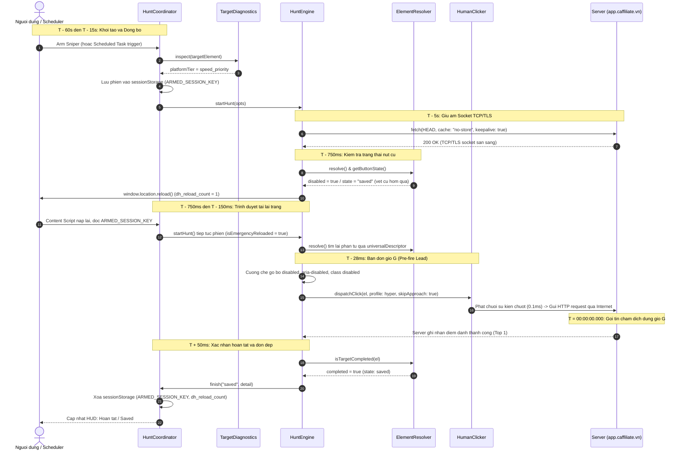

# Kien Truc Universal Sniper va May Trang Thai Hanh Vi (Behavioral State Machine)

Tai lieu nay mo ta chi tiet kien truc ky thuat, thuat toan loi, va luong xu ly dong bo cua he thong **DealHunter Universal Sniper** tren Chrome Extension (Manifest V3).

Cap nhat: 2026-10-09 · Dong bo voi ban build production va 192 unit tests.

---

## 1. Tong Quan Kien Truc Loi

He thong Sniper duoc xay dung dua tren cac thanh phan cot loi duoc to chuc ro rang:

```
┌────────────────────────────────────────────────────────────────────────┐
│                        HuntCoordinator (SSOT)                          │
│     (Quan ly trang thai tap trung, dieu phoi Arm manual va Schedule)   │
└──────────────▲──────────────────────────────────────────▲──────────────┘
               │                                          │
    Floating HUD (Manual UI)                  Background Scheduler (Auto)
               │                                          │
               ▼                                          ▼
       TargetDiagnostics                         chrome.alarms (MV3)
   (Static vs Reactive Analyzer)                 (Pre-warm tab o T-60s)
               │                                          │
               └────────────────────┬─────────────────────┘
                                    ▼
                             HuntEngine (Loi)
                 (Ticker 10ms, Timing Window, Adaptive Loop)
                                    │
                     ┌──────────────┴──────────────┐
                     ▼                             ▼
              ElementResolver                 HumanClicker
         (Behavioral State Machine)    (W3C Pointer Events Level 3)
```

1. **`HuntCoordinator`**: Single Source of Truth quan ly phien san, dong bo giua Floating HUD truc quan tren man hinh va Background Scheduler hen gio tu dong. Xu ly hop nhat phien (task adoption) va tiep noi phien sau khi reload trang thong qua `sessionStorage`.
2. **`HuntEngine`**: Co che click don dap adaptive sieu toc dua tren `WorkerTimer` (10ms tick), dieu phoi thoi gian lead (150ms truoc gio G), timing window (8000ms mac dinh, mo rong 10000ms sau reload) va co che phong thu kep.
3. **`TargetDiagnostics`**: Bo phan tich do tuong thich SPA (React/Vue/Angular), phan biet trang tinh va trang reactive de xac dinh chien luoc `dualDefenseReload` (tat reload tu dong tren cac trang SPA nhu Shopee).
4. **`ElementResolver`**: Thuat toan nhan dien phan tu, theo doi nut xuyen suot virtual DOM/React re-render va danh gia ket qua hoan tat dua tren may trang thai hanh vi khong phu thuoc ngon ngu.
5. **`HumanClicker`**: Phat chuoi su kien W3C Pointer Events Level 3 day du voi toa do Gauss 2 chieu tap trung trong tam nut va thoi gian tiep xuc phim vat ly (dwell time).

---

## 2. Loai Bo Triet De Hardcoded Text — May Trang Thai Hanh Vi

Toan bo cac regex tu dien van ban truoc day (`đã lưu`, `hết lượt`, `claimed`, `sold out`) da duoc go bo 100% va thay the bang **May trang thai hanh vi (Behavioral State Machine)** ket hop cac tieu chuan W3C DOM va HTML5:

### 2.1. Nhan dien ket qua sau khi click (Behavioral Mutations)
Khi da thuc hien it nhat 1 cu click ($clicksCount \ge 1$), trang thai hoan tat duoc xac dinh thong qua su bien doi thuc te cua phan tu trong DOM:

- **DOM Detachment / Unmount**: Neu `!button.isConnected`, phan tu da bi go khoi cay DOM (modal dong lai, card voucher duoc luu va bien mat). Ket qua: `saved`.
- **Idempotency Transition**: Neu phan tu chuyen sang `disabled`, `aria-disabled="true"`, hoac nhan class `.disabled` sau chuoi click. Day la co che chong click lap chuan cua cac he thong frontend. Ket qua: `saved`.
- **Text Mutation (Bien doi noi dung chu)**: Loai bo cac chuoi dem nguoc thoi gian (`\d{1,2}:\d{2}`) va so sanh `cleanCurrent !== cleanInitial`. Neu chu tren nut bien doi ngay sau khi click, he thong ghi nhan trang web da tiep nhan va phan hoi tuong tac thanh cong.
- **Subtree Icon Injection**: Kiem tra viec chen moi the SVG hoac bieu tuong mang ngu nghia hoan thanh (`check`, `tick`, `success`, `done`) vao ben trong nut hoac voucher card.
- **Voucher Card Behavioral Transition**: Kiem tra su bien doi cua toan bo container (`findVoucherContainer`) qua `getButtonState(card)`:
  - Chuyen sang `saved` khi the nhan them SVG icon hoan tat hoac dat trang thai `saved`.
  - Chuyen sang `exhausted` khi thanh tien do day (`progress[value="100"]`, `[aria-valuenow="100"]`, `[data-stock="0"]`) hoac class trang thai can kiet.

### 2.2. Xac nhan thong qua Toast / Notification / Live Region toan trang
Ham `checkPageToastConfirmation` quet cac vung thong bao noi tren toan trang (`[role="alert"]`, `[role="status"]`, `.toast`, v.v.) hoan toan doc lap voi ngon ngu (hoat dong tren moi phien ban Shopee / Lazada / Tiki quoc te):
- **Thanh cong (`saved`)**:
  - Phat hien SVG icon hoan tat: `hasCompletionIcon(el)` (duong dan path hoac class chua `check`, `tick`, `success`, `done`).
  - Hop dong du lieu HTML5: `data-type="success"` hoac `data-status="success"`.
  - Code tokens quoc te: `success`, `is-success`, `positive`, `completed`, `toast-success`, `alert-success`.
  - Vung cap nhat dong W3C ARIA: `role="status"` duoc kich hoat thong bao sau tuong tac.
- **Het luot / Can kiet (`exhausted`)**:
  - Phat hien icon loi/canh bao: SVG/Icon chua `warning`, `error`.
  - Hop dong du lieu HTML5: `data-type="error|warning|exhausted|depleted"`.
  - Code tokens: `error`, `is-error`, `warning`, `danger`, `exhausted`, `depleted`.

### 2.3. Danh gia trang thai truoc khi click (Pre-existing State Contracts)
Doi voi cac nut da luu hoac het luot truoc khi bat dau san:

- **Chuan W3C ARIA**: `aria-pressed="true"`, `aria-checked="true"`, `aria-selected="true"`.
- **Hop dong du lieu HTML5**: `data-state="checked"|"success"|"completed"|"saved"|"done"` va `data-status="success"|"completed"|"saved"`.
- **CSS Code Tokens**:
  - Hoan thanh: `completed`, `is-saved`, `btn-saved`, `claimed`, `checked`, `done`.
  - Can kiet: `exhausted`, `expired`, `soldout`, `sold-out`, `unavailable`, `ended`, `depleted`, `out-of-stock`.
  - Quota meter: `progress[value="100"]`, `[role="progressbar"][aria-valuenow="100"]`, `[data-stock="0"]`.
- **Loai tru phan tu phu (Secondary Elements)**:
  - W3C Dialog Opener: `aria-haspopup="dialog"`, `aria-haspopup="true"`.
  - Accordion trigger: `aria-expanded`, `aria-controls`.
  - The lien ket dieu huong: `role="link"`, the `<a>` co `href`.
  - Class phu tro: `secondary`, `detail`, `terms`, `condition`, `rules`, `info`, `more`, `dismiss`, `cancel`, `close`.

### 2.4. Chuan doan Standby trong TargetDiagnostics
Trang thai cho gio mo deal duoc danh gia khach quan qua:
- Bo dem gio trong container: Co chuoi thoi gian `\d{1,2}:\d{2}(?::\d{2})?`.
- Thuoc tinh vo hieu hoa: `disabled`, `aria-disabled="true"`, hoac class `.disabled`.
- Code tokens: `data-status="upcoming"|"standby"` hoac class `upcoming`, `standby`, `countdown`, `waiting`.

---

## 3. Thuat Toan Mo Phong Sinh Trac Hoc & Dieu Khien Co Hoc (Human Biometrics & Motor Control)

De loai bo cac dau vet tu dong hoa (automation signatures) ma cac he thong phong ve hien dai (DataDome, Cloudflare Turnstile, Shopee Risk Engine) quet va phat hien bot, he thong trien khai bo thuat toan sinh trac hoc toan dien tai [`human_biometrics.ts`](file:///Users/tiendn/Workplace/Projects/deal-hunter/dealhunter/extension/src/content/core/human_biometrics.ts):

### 3.1. Thuat toan bien doi Box-Muller (Phan phoi Gaussian cho thoi gian)
Hanh vi van dong cua con nguoi luon co phuong sai tu nhien tuan theo phan phoi Gauss $X \sim \mathcal{N}(\mu, \sigma^2)$:
$$Z_0 = \sqrt{-2 \ln(U_1)} \cos(2\pi U_2)$$
$$\Delta t = \mu + Z_0 \cdot \sigma$$
Trong do $U_1, U_2 \in (0, 1)$ la hai bien ngau nhien dong deu. Khoang cach giua hai lan click duoc tinh toan dong sau tung nhip va bi chan boi nguong sinh hoc $[t_{min}, t_{max}]$.

### 3.2. Phan bo diem cham 2 chieu (2D Bivariate Gaussian Spatial Distribution)
Nguoi that khong bao gio click vao cung mot toa do diem anh duy nhat va cung khong rai deu dong nhat. Mat va tay tap trung vao trong tam nut:
$$X_{rel} \sim \mathcal{N}(0.5, 0.10^2), \quad Y_{rel} \sim \mathcal{N}(0.5, 0.10^2)$$
Toa do thuc te duoc tinh dua tren bounding box:
$$\text{clientX} = \text{rect.left} + \text{rect.width} \cdot X_{rel}$$
$$\text{clientY} = \text{rect.top} + \text{rect.height} \cdot Y_{rel}$$
Voi $X_{rel}, Y_{rel} \in [0.25, 0.75]$ dam bao con tro luon nam trong vung an toan cua phan tu.

### 3.3. Quy dao tiep can chuot Cubic Bezier theo Dinh luat Fitts
O cu click dau tien, he thong mo phong quy dao tiep can tu vi tri truoc do:
$$B(t) = (1-t)^3 P_0 + 3(1-t)^2 t P_1 + 3(1-t) t^2 P_2 + t^3 P_3, \quad t \in [0, 1]$$
Dinh luat Fitts (Ease-Out Deceleration): Tham so $t$ duoc phan bo phi tuyen $t = 1 - (1 - \text{linearT})^2$, mo phong giam toc tu nhien khi con tro tien sat nut muc tieu kem cac su kien trung gian `pointermove` va `mousemove`.

### 3.4. Chuan hoa phan cung W3C Pointer Events Level 3
Moi click deu phat day du chuoi su kien phan cung:
- `pointerId: 1`
- `pointerType: "mouse"`
- `isPrimary: true`
- `pressure: 0.5` o pha `pointerdown`, `0.0` o pha `pointerup`
- `buttons: 1` khi de chuot, `buttons: 0` khi nha chuot
- `button: 0`, `which: 1`, `detail: 1`
- `bubbles: true`, `cancelable: true`, `composed: true`

### 3.5. Dong co dinh hinh dong hoc tu thich ung 3 pha (Autonomous Adaptive Kinetic Engine)
Dong co tu dong dieu chinh chu ky $\Delta t$ dua tren so luong click thuc te ma khong yeu cau nguoi dung phai chon che do thu cong:

```
[Gio G] ─────────────────────────────────────────────────────────────────►
├── Pha 1: But toc gio G (Clicks 1-3)
│   μ = 60ms, σ = 10ms (gioi han [45ms, 80ms]) -> Giat deal trong cua so vang
├── Pha 2: Gian nhip thich ung (Clicks 4-8)
│   μ = 95ms, σ = 16ms (gioi han [70ms, 130ms])
│   + Vi nghi phuc hoi co hoc 65ms ± 15ms truoc click 4 -> Pha vo chu ky bot
└── Pha 3: On dinh dai han (Clicks 9+)
    μ = 140ms, σ = 22ms (gioi han [100ms, 190ms])
    + Vi nghi dinh ky moi 5 clicks -> Bao ve tai khoan an toan
```

Thuat toan tinh pacing duoc dong bo chat che (`computeNextInterval(profile, 1)` o nhip dau va `computeNextInterval(profile, clicks + 1)` sau moi click), dam bao vi nghi phuc hoi co hoc xuat hien chinh xac ngay truoc cu click thu 4.

### 3.6. Loai bo gioi han 80 clicks co dinh (Dynamic Window Pacing)
- Truoc day he thong ton tai gioi han gia tao `maxClicks: 80`. Gioi han nay da duoc go bo hoan toan (`maxClicks: Infinity` theo mac dinh).
- Phien san duoc dieu phoi hoan toan boi:
  1. Cua so san vang thuc te (`windowMs: 8000ms`, hoac 10000ms neu reload phong thu kep).
  2. Nhip sinh hoc cua Dong co Kinetic 3 pha: Tu dong giam tan suat va nghi ngoi hop ly nhu thao tac tay con nguoi.
  3. May trang thai phan ung tu nhien: Dung ngay khi voucher duoc xac nhan da luu (`saved`) hoac het hang (`exhausted`).

---

## 4. Thong Nhat 100% Giua Arm Sniper va Schedule

Hai che do "Arm Sniper" (kich hoat truc tiep tren Floating HUD) va "Schedule" (hen gio ngam tu Background) chia se cung mot co che cot loi thong qua `HuntCoordinator`:

```
[User bam Arm tren HUD] ──────────┐
                                  ├──► HuntCoordinator.arm() ────────► HuntEngine
[Alarm Scheduler kich hoat] ──────┴──► HuntCoordinator.armFromTask() ──┘
```

1. **Quan ly phien tap trung**: `HuntCoordinator` dam bao tai mot thoi diem chi co duy nhat 1 instance `HuntEngine` hoat dong tren tab. Neu co phien manual cung thoi diem, he thong tu dong gop phien ma khong huy ngang.
2. **Bao toan phien qua Reload (`sessionStorage`)**:
   - Khoa session `dh_armed_session` luu tru target descriptor, thoi gian muc tieu va thong tin task.
   - Khi tab reload, content script kiem tra va tiep tuc phien san ngay lap tuc ma khong lam mat vi tri nut.
3. **So khop URL chuan hoa (`isSamePageUrl`)**:
   - So sanh ca origin, pathname, hash route va query parameters (loai tru rieng cac tham so tiep thi `utm_*`, `fbclid`).
   - Ngan ngua tinh trang nhan dien sai tab khi nguoi dung mo nhieu trang su kien khac nhau.

---

## 5. Co Che Tu Toi Uu Phong Thu Kep (Dual-Defense Reload)

### 5.1. Quy trinh hoat dong
1. **Pre-warm (T-60s tu Background Scheduler)**:
   - Danh thuc service worker qua `chrome.alarms`.
   - Tai su dung tab hop le (`isSamePageUrl`) hoac mo tab moi.
   - Cho su kien `tabs.onUpdated` chuyen sang `status === "complete"` truoc khi gui tin nhan kich hoat de tranh race condition.
2. **Emergency Reload (T+250ms trong HuntEngine)**:
   - Chi ap dung khi:
     - Thoi gian da qua gio G 250ms.
     - So luot click hien tai bang 0 va nut van bi vo hieu hoa (stale DOM tren trang tinh).
     - Nhiem vu cho phep reload (`task.dualDefenseReload !== false`).
     - Trang khong phai la reactive SPA (`diagnostics.strategy !== "reactive_no_reload"`).
3. **Cua so mo rong 10 giay sau reload**:
   - Dat co `dh_emergency_reloaded_${DROP}` trong `sessionStorage`.
   - Mo rong cua so thoi gian len 10,000ms de bu tru thoi gian tai lai ma HTML va API.
   - Khoa chong lap vo han: chi reload toi da 1 lan duy nhat cho moi moc gio.

---

## 6. Bao Mat va Quan Ly Du Lieu

1. **Don dep domain calibrations (P2 & L11)**:
   - Du lieu can chinh gio cua tung domain duoc quan ly qua chuoi Promise `calibrationWrites` trong `src/lib/storage.ts`.
   - Tu dong loc va xoa cac domain calibration da qua 24 gio (>86,400,000 ms) moi lan ghi du lieu, tranh luu lai lich su duyet web lau dai.
2. **Kiem tra URL nghiem ngat (L2 & P4)**:
   - Ham `isValidHttpUrl` tu choi tat ca cac giao thuc phi cau truc (`javascript:`, `file:`, `chrome://`, `data:`, `blob:`, `about:`).
3. **Xac thuc tin nhan Service Worker**:
   - Background kiem tra nguon tin nhan `sender.id === chrome.runtime.id` va chan ket noi trai phep tu cac extension khac.
   - Thiet lap `externally_connectable` trong `manifest.json` chi ket noi voi cac origin tin cay duoc phep (`DEALHUNTER_WEB_ORIGINS`).

---

## 7. Kien Truc Da Nen Tang (Multi-Platform E-Commerce Architecture)

He thong khong gioi han o Shopee ma ho tro dong nhat tren moi san thuong mai dien tu va nen tang ban ve:

1. **Marketplace Adapters & Registry (`src/content/adapters/`)**:
   - `ShopeeAdapter`: Ho tro Shopee toan cau (`shopee.*` tai VN, TH, ID, MY, PH, SG, TW, BR).
   - `LazadaAdapter`: Ho tro Lazada Dong Nam A (`lazada.*` tai VN, TH, PH, SG, MY, ID) va trich xuat thong tin san pham.
   - `TikiAdapter`: Ho tro san Tiki (`tiki.vn`), nhan dien voucher/khuyen mai va trich xuat gia/ma san pham.
   - `TikTokAdapter`: Ho tro TikTok Shop (`shop.tiktok.com`, `tiktok.com`) va trich xuat gia/san pham.
   - Registry `getAdapterForUrl(url)`: Tu dong phan giai adapter phu hop theo URL trang hien tai.
2. **Nhan dien trang deal / voucher da san (`isECommerceVoucherOrDealPage`)**:
   - Quet cac mau duong dan chien dich (`/voucher`, `/coupon`, `/ma-giam-gia`, `/khuyen-mai`, `/flash-sale`, `/cart`, `/checkout`, `/wow/`, `/m/`) tren tat ca cac domain e-commerce (Shopee, Lazada, Tiki, TikTok Shop, Sendo, Amazon, AliExpress, Taobao).
   - Tu dong kich hoat Floating HUD ma khong can thao tac thu cong.
3. **Phat hien chuyen huong Captcha / Xac minh (`detectPlatformAuthOrCaptchaBlock`)**:
   - Xu ly kiem tra trang thai xac minh / dang nhap cho tung san (Shopee `/verify/`, Lazada `/verification/` hoac `/punish`, Tiki `/customer/account/login`, TikTok Shop `/verify` hoac `/login`, va cac trang captcha tong quat).
   - Canh bao som cho nguoi dung truoc gio G de tranh loi phien san.
4. **Bo chon thong bao da nen tang**:
   - Quet cac container thong bao dac thu cua tung san: `.shopee-toast`, `.next-feedback-toast`, `.lzd-toast`, `.arco-message` (ByteDance/TikTok), `.tiki-toast`, `.ant-message`, kem theo cac container W3C ARIA Live Regions.

---

## 8. Chien Luoc Phan Tang Nen Tang & Toi Uu Hyper-Strike

De can bang giua hai muc tieu: (1) An toan tuyet doi truoc he thong quet bot cua cac san lon, va (2) Toc do toi da de chien thang Top 1 tren cac trang diem danh / doi thuong / ban ve toc do cao (`caffiliate.vn`, v.v.), he thong trien khai kien truc **Phan tang nen tang tu dong (Tiered Platform Strategy)**:

### 8.1. Phan tang tu dong (`isMajorMarketplace`)
Ham `isMajorMarketplace` phan chia pham vi hoat dong:
- **`major_marketplace` (Shopee, Lazada, TikTok Shop)**:
  - Giu nguyen mo hinh sinh trac hoc chuan: quy dao tiep can chuot cong Bezier Fitts's Law o click dau tien, duong bao dong hoc Gaussian 3 pha (`adaptive`), khong can thiep DOM tho bao de tranh kich hoat MutationObserver cua DataDome / Cloudflare / Shopee Risk Engine.
- **`speed_priority` (Trang diem danh `caffiliate.vn`, web dat ve, mini-game, v.v.)**:
  - Tu dong chuyen sang ho so nhap chuot `hyper` (khoang cach 25ms, ~40 CPS, dwell time 8ms).
  - Bo qua quy dao chuot Bezier o click dau tien (`skipApproach: true`), dispatch su kien tuc thi trong 0.1ms.
  - Co che **Ban don gio G (Pre-fire Lead Offset)**: Tinh toan do tre mang Internet ($RTT / 2 \approx 28ms$), kich no chuoi click tu $T - 28ms$ de goi tin HTTP cham cong may chu dung vao tich tac $00:00:00.000$.
  - **Cuong che thao do `disabled` tren DOM**: Tai thoi diem ban don ($T - 28ms$), neu muc tieu da duoc khoa boi nguoi dung, extension chu dong go bo thuoc tinh `disabled`, `aria-disabled="false"`, va class `.disabled` tren DOM ma khong thu dong ngoi cho React re-render cycle (tiet kiem 30ms - 80ms).

### 8.2. Chien luoc Reload don dau co kiem soat (Guarded Precision Pre-Reload Loop)
Tren cac trang React SPA khong co co che tu dong mo khoa nut theo thoi gian thuc ma can reload trang de lay session ngay moi (`caffiliate.vn`):
1. **T - 5s (Keep-Alive Socket Pre-warming)**:
   - Ngam gui request `HEAD` voi `cache: "no-store"` va `keepalive: true` toi origin server de giu am socket TCP/TLS, tranh ton thoi gian bat tay TLS handshake khi click.
2. **T - 750ms (Precision Pre-Reload)**:
   - Neu nut muc tieu van o trang thai khoa cua ngay hom truoc (`disabled` hoac `saved`), tu dong kich hoat reload truoc 750ms de trang kip hoan tat tai lai ma va CSS truoc gio G 100ms - 200ms.
3. **Cua so 3 giay quanh gio G ($[T - 750ms, T + 2250ms]$)**:
   - Ap dung co che reload lap lai co kiem soat qua `sessionStorage` (`dh_reload_count_${DROP}`):
   - Toi da 3 lan reload, moi lan cach nhau toi thieu 650ms de tranh spam may chu.
   - **Vua phat hien nut kha dung (`isTargetClickable && state !== "saved"`) la lap tuc dung reload va click ngay (0ms tre)**.
   - Khi co click thanh cong hoac deal hoan tat, tu dong don dep toan bo bien dem trong `sessionStorage`.

### 8.3. Luong Xu Ly Chi Tiet Toan Dien (End-to-End Execution Flow)

Duoi day la luong tuong tac chi tiet giua cac thanh phan tu luc khoi tao den khi hoan tat cu click Top 1:



### 8.4. Ma Tran Tien Trinh Thoi Gian Mili-Giay (Chronological Timeline Matrix)

Bang duoi day mo ta hanh vi cua he thong tai tung moc thoi gian xung quanh gio G doi voi cac nen tang `speed_priority`:

| Moc Thoi Gian | Hanh Dong Chinh | Muc Dich Ky Thuat | Thanh Phan Xu Ly |
| :--- | :--- | :--- | :--- |
| **$T - 60s \to T - 20s$** | Pre-warm Tab & Calibration | Bat tab len front, focus window, dong bo dong ho 3 vong voi server qua tieu de `Date`. | `TaskScheduler`, `TimeCalibrator` |
| **$T - 15s$** | Clean Tab & Arm Verify | Lam sach session/DOM tren tab cu neu can, kiem tra khoa nut va tao snapshot descriptor. | `TaskScheduler`, `HuntCoordinator` |
| **$T - 5s$** | Socket Keep-Alive Ping | Gui request `HEAD` ngam giu ket noi TCP/TLS mo san, triet tieu 30ms-80ms bat tay TLS. | `HuntEngine` |
| **$T - 750ms$** | Precision Pre-Reload | Neu nut muc tieu van bi khoa boi phien hom qua, reload truoc 750ms de DOM kip mount truoc gio G 150ms. | `HuntEngine` |
| **$T - 750ms \to T - 150ms$** | Fast In-Memory Reload | Trinh duyet tai lai trang tu bo nho dem cache, content script khoi phuc phien tu `sessionStorage`. | `HuntCoordinator`, `ElementResolver` |
| **$T - 28ms$** | Pre-fire Lead & DOM Unblock | Cuong che go `disabled`, bo qua quy dao chuot Bezier, dispatch chuoi su kien tuc thi trong 0.1ms. | `HuntEngine`, `HumanClicker` |
| **$T - 28ms \to T = 0ms$** | Network Transit Window | Goi tin HTTP di chuyen qua ha tang mang Internet (~25-30ms ping RTT). | Internet / Network Layer |
| **$T = 00:00:00.000$** | Server Arrival (Diem G) | Goi tin cham may chu dung tich tac server mo cong ngay moi, an tron moc 00:00:00. | Origin Server (`caffiliate.vn`) |
| **$T + 250ms \to T + 2250ms$** | Guarded Reload Loop | Neu server cap nhat cham hoac chua mo nut, reload lap lai toi da 3 lan (cach nhau $\ge 650ms$). Vua co nut la click ngay. | `HuntEngine` |
| **$T + 50ms \to T + 500ms$** | Completion Verification | Nhan dien nut bien doi sang da diem danh/saved, dung ban, cap nhat UI va don dep storage. | `ElementResolver`, `HuntCoordinator` |

---

## 9. So Sanh Phan Tang Nen Tang (Platform Tiering Matrix)

He thong tu dong ap dung chien luoc rieng biet tuy thuoc vao do nhay cam cua he thong chong bot tren tung nen tang:

| Dac Tinh Ky Thuat | Sàn Lớn (`major_marketplace`) | Trang Tốc Độ Cao (`speed_priority`) |
| :--- | :--- | :--- |
| **Nền tảng áp dụng** | Shopee, Lazada, TikTok Shop | `caffiliate.vn`, ticketbox, web đổi thưởng, điểm danh, mini-game |
| **Hồ sơ nhấp chuột** | `adaptive` (Surge $\to$ Adaptation $\to$ Steady) | `hyper` (Cực đại 25ms, ~40 CPS, dwell 8ms) |
| **Quỹ đạo chuột** | Đường cong Bezier Fitts's Law 4 bước | Bỏ qua hoàn toàn (`skipApproach: true`), tức thì 0.1ms |
| **Bắn đón giờ G** | Không ($T - 0ms$) để tránh gửi request trước giờ bị sàn khóa | Có ($T - 28ms \approx RTT / 2$) bù đắp độ trễ mạng |
| **Can thiệp DOM `disabled`** | Không can thiệp (tránh MutationObserver của DataDome quét) | Chủ động gỡ bỏ `disabled`, `aria-disabled`, class `disabled` tại giờ G |
| **Pre-reload $T - 750ms$** | Tắt mặc định (trang SPA tự cập nhật qua WebSocket/Timer) | Bật tự động nếu nút vẫn mang trạng thái hôm qua |
| **Guarded Reload Loop** | Chỉ reload khi cấu hình tường minh | Tự động lặp lại tối đa 3 lần trong cửa sổ $[T - 750ms, T + 2250ms]$ |
| **Mục tiêu ưu tiên** | An toàn 100% trước WAF/Bot Filter | Tốc độ tối đa, đoạt Top 1 tuyệt đối tại $00:00:00.000$ |

---

## 10. Co Che Phong Thu va Xu Ly Ngoai Le (Fault Tolerance & Edge Case Recovery)

1. **Bao toan trang thai qua Reload (Cross-Reload State Continuity)**:
   - Moi thong tin san gom `targetTimestamp`, `universalDescriptor`, `diagnostics`, `clickProfileMode`, `dualDefenseReload` duoc luu tai `sessionStorage` (`ARMED_SESSION_KEY`).
   - Khi trang web reload (du do F5 thu cong hay tu dong reload cua he thong), Content Script nap lai se doc ngay `ARMED_SESSION_KEY`, tu dong arm lai `HuntCoordinator` va dinh vi lai nut trong vong 10ms.
2. **Tu dong tai dinh vi nut khi React re-render**:
   - Khi React huy phan tu DOM cu va chen phan tu DOM moi vao cay tai gio G, `elementResolver.relocateUniversal(desc)` su dung chu ky noi dung (`matchesContentSignature`) va bo neo vi tri (`documentTop`, `ancestorSelector`) de tim lai nut moi trong 1 tick (10ms), khong lam dut gay chuoi click.
3. **Chong click lap vao trang thai cu hom truoc**:
   - Neu tai gio G nut tren man hinh van dang o trang thai `saved` tu ngay hom truoc, he thong kiem tra `state !== "saved"` truoc khi ban click, tranh lang phi luot click vao nut chua duoc lam moi.
4. **Gioi han reload chong spam (Anti-Spam Reload Throttling)**:
   - Moi lan reload duoc ghi nhan vao `dh_reload_count_${DROP}` va `dh_last_reload_time_${DROP}` trong `sessionStorage`.
   - Chi cho phep reload cach nhau toi thieu 650ms va toi da 3 lan trong cua so 3 giay. Khi so luot click $\ge 1$, co che reload bi khoa hoan toan.

---

## 11. Quy Chuan Chat Luong va Kiem Thu

- **Unit Tests**: 200/200 tests pass tren 18 test suites (`npx vitest run`).
- **Type Checking**: Clean 100% khong loi qua `npx tsc --noEmit`.
- **Production Build**: Bien dich hoan tat sach se `popup.js`, `background.js`, `content.js` va `content.css`.
- **Zero-Emoji**: Tuyet doi khong su dung emoji trong ma nguon, log, test va tai lieu.
