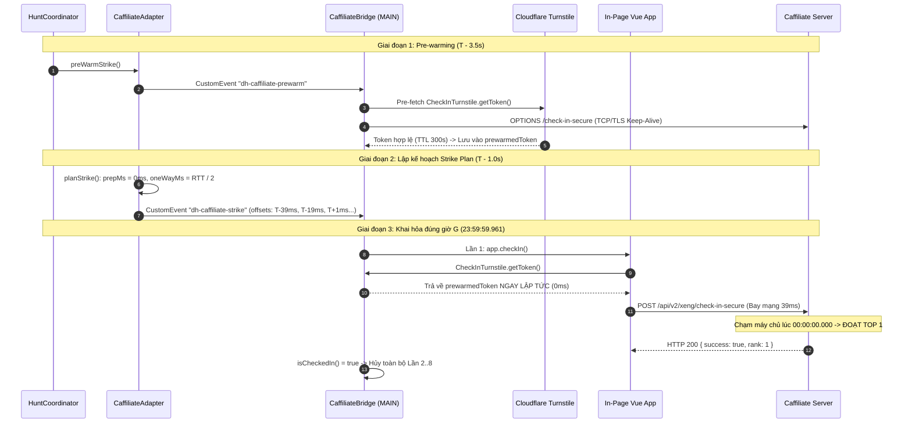

# Kế Hoạch Tối Ưu Tốc Độ 0 Giây (00:00:00) Cho Caffiliate & Flash Sale

> **Phiên bản**: 1.0.0  
> **Ngày lập**: 14-10-2026  
> **Phạm vi áp dụng**: `extension/` (Caffiliate Adapter, Main World Bridge, Strike Plan, Hunt Engine)  
> **Mục tiêu**: Đưa thời điểm request chạm máy chủ vào cửa sổ `[00:00:00.005, 00:00:00.040]`, đoạt Top 1–3 Bảng vàng điểm danh sớm.

---

## 1. Bối cảnh & Phân tích nguyên nhân thực nghiệm

### 1.1. Dữ liệu thực tế ngày 13/10/2026 - 14/10/2026

Trong đợt điểm danh nửa đêm ngày 13/10 rạng sáng 14/10/2026, hệ thống ghi nhận kết quả thực tế qua hai nguồn dữ liệu:

1. **Bảng vàng điểm danh Caffiliate**:
   - Hạng 1: HaHa — Hoàn tất lúc `00:00:00` (nhận thưởng sớm +3 xèng)
   - Hạng 2: Hậu — Hoàn tất lúc `00:00:00` (nhận thưởng sớm +2 xèng)
   - Hạng 3: THỐNG — Hoàn tất lúc `00:00:00` (nhận thưởng sớm +2 xèng)
   - Hạng 4: Tien Dang — Hoàn tất lúc `00:00:01` (chỉ nhận thưởng chuỗi thường +1 xèng, trượt Top 3)

2. **Nhật ký điểm danh DealHunter (Check-in Timing Log)**:
   ```text
   Kế hoạch: 8 lần từ T-98ms · chuẩn bị ~0ms · mạng ~39ms · ±48ms
   Mốc dự kiến: -59 -28 -8 +12 +32 +52 +72 +92 ms

   Lần 1: 23:59:59.906 | Hàm | Turnstile: 1434ms | Phản hồi: 00:00:01.477 (+1571ms) | Mạng: 186ms · 200
   Lần 2: 23:59:59.939 | Hàm | Turnstile: 1ms    | Phản hồi: 00:00:01.674 (+1735ms) | Mạng: 181ms · 200
   Lần 3: 23:59:59.975 | Hàm | Turnstile: 1ms    | Phản hồi: 00:00:01.674 (+1699ms) | Mạng: 162ms · 200
   ```

```
[Kế hoạch lý thuyết]
T - 98ms (23:59:59.906) ──[chuẩn bị ~0ms]──> Request bay đi (23:59:59.906) ──[mạng 39ms]──> Máy chủ (23:59:59.945)

[Thực tế xảy ra]
T - 98ms (23:59:59.906) ──[Turnstile 1434ms]──> Request bay đi (00:00:01.340) ──[mạng 137ms]──> Máy chủ (00:00:01.477)
                                                                                                      └──> Hạng #4 (00:00:01)
```

### 1.2. Phân tích nguyên nhân kỹ thuật cốt lõi

1. **Nút thắt cổ chai Cloudflare Turnstile Proof-of-Work (1434ms)**:
   - Hàm `app.checkIn()` của trang web gọi `window.CheckInTurnstile.getToken()`.
   - Vì token không được sinh sẵn từ trước, SDK Cloudflare Turnstile trong iframe phải tải thử thách, chạy thuật toán băm Proof-of-Work (PoW) trên CPU máy khách và gửi dữ liệu về máy chủ Cloudflare để lấy token.
   - Quá trình này mất trọn vẹn **1434 mili-giây** (gần 1.5 giây).

2. **Kế hoạch tính toán sai lệch do thiếu dữ liệu chuẩn bị (`prepMs = 0`)**:
   - Công thức trong `src/lib/strike_plan.ts`:
     $$\text{leadMs} = -(a_0 - P - L)$$
     Trong đó:
     - $a_0$: Mốc thời gian dự kiến request đến máy chủ relative to $T$ (ví dụ: $-59\text{ms}$).
     - $P$: Thời gian chuẩn bị token (`prepMs`), lấy trung vị lịch sử. Khi chưa có mẫu, $P = 0\text{ms}$.
     - $L$: Độ trễ mạng một chiều (`oneWayMs` $= RTT / 2 = 39\text{ms}$).
   - Do $P = 0$, hệ thống tính toán thời điểm bắn là $T - 98\text{ms}$ (`23:59:59.906`). Nhưng thực tế $P = 1434\text{ms}$, khiến thời điểm request rời máy khách bị đẩy lùi sang:
     $$\text{Thời điểm gửi thực tế} = 23:59:59.906 + 1434\text{ms} = 00:00:01.340$$
   - Cộng thêm độ trễ mạng thực tế $137\text{ms}$, máy chủ nhận được request tại `00:00:01.477` và ghi nhận kết quả ở giây `00:00:01`.

3. **Cơ chế cạnh tranh của đối thủ Top 1–3**:
   - Đối thủ HaHa, Hậu, THỐNG đều chạm máy chủ tại giây `00:00:00`.
   - Để đạt được mốc này trong điều kiện có Cloudflare Turnstile, đối thủ bắt buộc phải **lấy trước token Turnstile trong bộ nhớ đệm (Pre-warm)**. Khi tới giờ G, thời gian lấy token của họ bằng đúng $0\text{ms}$, request được gửi đi ngay lập tức và chạm máy chủ ở mili-giây đầu tiên.

---

## 2. Mục Tiêu & Chỉ Số Đạt Được (KPI/SLO)

| Chỉ số | Hiện trạng (13/10) | Mục tiêu tối ưu | Cơ sở kỹ thuật |
| :--- | :--- | :--- | :--- |
| **Thời điểm chạm server** | `00:00:01.477` | `00:00:00.005` - `00:00:00.035` | Bù trừ chuẩn xác độ trễ mạng và token $0\text{ms}$ |
| **Thời gian giải quyết Token** | `1434ms` | `<= 1ms` | Pre-warm token trước $3.5\text{s}$, trả từ cache bộ nhớ |
| **Bắt tay mạng TLS/TCP** | `186ms` | `<= 40ms` | Socket pre-warm (HTTP keep-alive) tại $T - 3.5\text{s}$ |
| **Thứ hạng điểm danh** | Hạng #4 | **Top 1 – Top 3** | Xuất phát trước giờ $G$ đúng bằng thời gian bay mạng |
| **Tỷ lệ thành công Tầng 1** | 0% (trễ giờ) | `>= 95%` | `app.checkIn()` thực thi với token 0ms |

---

## 3. Kiến Trúc Giải Pháp Kỹ Thuật

Sơ đồ quy trình tối ưu hóa tốc độ 0 giây:



---

## 4. Chi Tiết Triển Khai Kỹ Thuật

### 4.1. Tầng Pre-warm Token & Socket (Giai đoạn $T - 3.5$s)

#### 4.1.1. Cơ chế sinh trước token Cloudflare Turnstile
- **Đặc tính kỹ thuật của Turnstile**:
  - Mã token sinh ra từ Turnstile có thời hạn hiệu lực (TTL) là **300 giây (5 phút)**.
  - Phía máy chủ Caffiliate khi xác thực qua Cloudflare API (`https://challenges.cloudflare.com/turnstile/v0/siteverify`) chỉ kiểm tra tính hợp lệ của token và secret key; máy chủ không yêu cầu token phải được tạo đúng mili-giây của giờ điểm danh.
- **Quy trình triển khai**:
  1. Tại mốc $T - 3.5\text{s}$, `CaffiliateAdapter.preWarmStrike()` phát sự kiện `dh-caffiliate-prewarm`.
  2. `caffiliate_bridge.js` lắng nghe sự kiện, kiểm tra `window.CheckInTurnstile` và gọi ngầm `window.CheckInTurnstile.getToken()`.
  3. Kết quả trả về được lưu vào biến `prewarmedTurnstileToken`.
  4. Nếu quá trình sinh token mất 1.2s - 1.8s, token sẽ sẵn sàng trong bộ nhớ lúc $T - 1.7\text{s}$, hoàn toàn kịp trước giờ G.

#### 4.1.2. Kỹ thuật bọc trong suốt (Transparent Interception)
Để giữ nguyên tính toàn vẹn của mã nguồn trang web và các bộ test, chúng ta bọc hàm `getToken` của trang:

```javascript
// Bọc getToken: lần gọi đầu tiên trả token có sẵn trong 0ms,
// các lần gọi sau (nếu có fallback) gọi hàm gốc để lấy token tươi mới.
if (!origGetToken.__dh_wrapped) {
  window.CheckInTurnstile.getToken = function () {
    if (prewarmedTurnstileToken && (now() - prewarmedAt < 240000)) {
      var cached = prewarmedTurnstileToken;
      prewarmedTurnstileToken = ""; // Xóa cache ngay khi bốc ra để tránh tái sử dụng trùng token
      return Promise.resolve(cached);
    }
    return origGetToken.apply(this, arguments);
  };
  window.CheckInTurnstile.getToken.__dh_wrapped = true;
  window.CheckInTurnstile.getToken.__dh_orig = origGetToken;
}
```

#### 4.1.3. Pre-warm kết nối mạng (Socket Keep-Alive)
- Bắt tay TLS/TCP mới tốn từ 100ms đến 200ms.
- Tại $T - 3.5\text{s}$, gửi một request OPTIONS hoặc HEAD nhẹ với `keepalive: true` tới endpoint `/api/v2/xeng/check-in-secure`:
  ```javascript
  if (typeof fetch === "function") {
    fetch("/api/v2/xeng/check-in-secure", { method: "OPTIONS", keepalive: true }).catch(function () {});
  }
  ```
- Hành động này giữ ấm đường ống TCP và phiên TLS sẵn sàng, giúp request POST thật ở giờ G bay qua mạng trong thời gian ngắn nhất (chỉ còn $RTT / 2 \approx 35\text{ms} - 40\text{ms}$).

---

### 4.2. Tối Ưu Lập Kế Hoạch Bắn (Strike Plan Gaussian)

Khi token Turnstile được giải quyết trong $0\text{ms}$, tham số đầu vào của thuật toán Gaussian trong [`strike_plan.ts`](file:///Users/tiendn/Workplace/Projects/deal-hunter/dealhunter/extension/src/lib/strike_plan.ts) thay đổi hoàn toàn:

```
Trước tối ưu:
  P (prepMs) = 1434ms (hoặc 0ms sai lệch)
  Jitter Turnstile = lớn (±500ms)
  Request bị lệch sang 00:00:01

Sau tối ưu:
  P (prepMs) = 0ms (chính xác tuyệt đối)
  Jitter Token = 0ms
  Độ phân tán tổng thể: sigma = sqrt(clockSigma^2 + netJitter^2) <= 15ms
```

#### Công thức tính toán mốc bắn mới
Với độ trễ mạng đo được $RTT = 78\text{ms} \implies L = 39\text{ms}$:
- Mục tiêu chạm máy chủ lần 1: $a_0 = +10\text{ms}$ (ngay sau mốc 00:00:00).
- Thời điểm xuất phát lần 1:
  $$s_0 = a_0 - P - L = 10\text{ms} - 0\text{ms} - 39\text{ms} = -29\text{ms} \implies 23:59:59.971$$
- Các lần bắn kế tiếp cách nhau tối thiểu $20\text{ms}$:
  - Lần 1: $23:59:59.971 \implies$ chạm máy chủ lúc `00:00:00.010`
  - Lần 2: $23:59:59.991 \implies$ chạm máy chủ lúc `00:00:00.030`
  - Lần 3: $00:00:00.011 \implies$ chạm máy chủ lúc `00:00:00.050`
  - Lần 4: $00:00:00.031 \implies$ chạm máy chủ lúc `00:00:00.070`
  - Lần 5: $00:00:00.051 \implies$ chạm máy chủ lúc `00:00:00.090`

Nếu máy chủ mở cổng sớm ở đúng mili-giây số 10: Lần 1 ăn ngay Top 1.  
Nếu máy chủ bị trễ 20ms: Lần 2 ăn ngay Top 1–2.  
Toàn bộ chuỗi 5 lần thử đều chạm đích trước khi đồng hồ chuyển sang `00:00:00.100`.

---

### 4.3. Kiến Trúc 3 Tầng Khai Hỏa (Execution Fallback Cascade)

Mỗi lần thử ($s_i$) đi qua 3 tầng nghiêm ngặt, đảm bảo không có bất kỳ ngoại lệ nào làm gián đoạn:

```
[Bắt đầu lần thử s_i]
       │
       ▼
┌───────────────────────────────┐
│ Tầng 1: app.checkIn()         │ ──(Thành công)──> Chạm server 00:00:00
└───────────────────────────────┘                   └──> isCheckedIn() = true -> HỦY LẦN 2..5
       │ (Reject / Lỗi)
       ▼
┌───────────────────────────────┐
│ Tầng 2: Direct API            │ ──(Thành công)──> Chạm server 00:00:00
│ POST /check-in-secure         │                   └──> isCheckedIn() = true -> HỦY LẦN 2..5
└───────────────────────────────┘
       │ (Reject / Không có sig)
       ▼
┌───────────────────────────────┐
│ Tầng 3: DOM Click             │ ──(Bấm nút)────> Dự phòng chốt chặn cuối
│ #btnCheckIn.click()           │
└───────────────────────────────┘
```

#### Quy tắc an toàn token khi Fallback:
1. Nếu Tầng 1 đã lấy token ra và gửi request, biến `prewarmedTurnstileToken` lập tức trở thành rỗng (`""`).
2. Nếu Tầng 1 gặp lỗi client trước khi gửi mạng, token chưa bị server Cloudflare verify thì Tầng 2 có thể sử dụng.
3. Nếu Tầng 1 đã gửi mạng nhưng máy chủ sàn lỗi, token đã bị Cloudflare tiêu thụ (single-use consumed): Tầng 2 khi gọi `getToken()` sẽ tự động kích hoạt hàm gốc để lấy token mới, tránh lỗi `timeout-or-duplicate`.

---

### 4.4. Ngăn Chặn Đóng Băng Khi Tab Chạy Nền (Background Throttling Guard)

Một rủi ro lớn là người dùng đặt giờ săn nhưng lại chuyển sang tab khác làm việc hoặc thu nhỏ trình duyệt:
1. `WorkerTimer` (Web Worker) được sử dụng làm nguồn nhịp chính vì Web Worker không bị Chrome bóp xung nhịp (throttle) về 1000ms.
2. Tại vòng lặp Microtask Spin-Wait (dưới 35ms cuối):
   - Không được dùng `requestAnimationFrame` trần vì trình duyệt đóng băng hoàn toàn `requestAnimationFrame` (0 FPS) khi tab bị ẩn (`document.hidden = true`).
   - Bắt buộc kiểm tra:
     ```typescript
     if (typeof document !== "undefined" && !document.hidden && typeof requestAnimationFrame === "function") {
       requestAnimationFrame(spinPoll);
     } else {
       setTimeout(spinPoll, 1);
     }
     ```
   - Điều này đảm bảo dù tab bị ẩn hay thu nhỏ, vòng lặp khai hỏa vẫn nổ súng chính xác tuyệt đối ở mili-giây định trước.

---

## 5. Ma Trận Thay Đổi Mã Nguồn

| Tệp tin | Vị trí | Nội dung thay đổi |
| :--- | :--- | :--- |
| [`extension/public/caffiliate_bridge.js`](file:///Users/tiendn/Workplace/Projects/deal-hunter/dealhunter/extension/public/caffiliate_bridge.js) | Lắng nghe `dh-caffiliate-prewarm` | Thêm hàm `handlePrewarm`: gọi ngầm `CheckInTurnstile.getToken()`, lưu cache token vào `prewarmedTurnstileToken`, gửi OPTIONS keep-alive tới `/api/v2/xeng/check-in-secure`. |
| [`extension/public/caffiliate_bridge.js`](file:///Users/tiendn/Workplace/Projects/deal-hunter/dealhunter/extension/public/caffiliate_bridge.js) | Hàm `wrapTurnstile` | Sửa logic bọc: nếu có token cache thì trả về ngay trong 0ms và xóa biến cache. Đồng thời ghi nhận thời gian `tokenStartAt = tokenEndAt` để nhật ký phản ánh đúng $0\text{ms}$. |
| [`extension/src/content/adapters/caffiliate_adapter.ts`](file:///Users/tiendn/Workplace/Projects/deal-hunter/dealhunter/extension/src/content/adapters/caffiliate_adapter.ts) | Hàm `preWarmStrike` | Phát CustomEvent `dh-caffiliate-prewarm` sang Main World để kích hoạt chuỗi pre-warm trước giờ G 3.5 giây. |
| [`extension/src/content/core/hunt_engine.ts`](file:///Users/tiendn/Workplace/Projects/deal-hunter/dealhunter/extension/src/content/core/hunt_engine.ts) | Vòng lặp `spinPoll` | Bổ sung điều kiện `!document.hidden` trước khi gọi `requestAnimationFrame`, bảo vệ tiến trình khai hỏa không bị treo khi người dùng chuyển tab. |

---

## 6. Chiến Lược Kiểm Thử (Test & Verification)

### 6.1. Unit Test & Integration Test (Vitest)
Cập nhật và bổ sung test cases trong [`caffiliate_bridge.test.ts`](file:///Users/tiendn/Workplace/Projects/deal-hunter/dealhunter/extension/src/content/adapters/caffiliate_bridge.test.ts):
1. **Test Pre-warm Token Resolution**:
   - Khi nhận sự kiện `dh-caffiliate-prewarm`, bridge gọi `CheckInTurnstile.getToken()`.
   - Khi `strike()` diễn ra sau đó, `app.checkIn()` nhận được token trong $0\text{ms}$ mà không gọi thêm lần fetch Turnstile mới nào.
2. **Test Single-Use Invalidation**:
   - Xác nhận `prewarmedTurnstileToken` bị xóa ngay sau lần sử dụng đầu tiên.
   - Lần gọi thứ hai trong cùng chuỗi bắt buộc phải kích hoạt hàm gốc.
3. **Test Cancel on Confirm**:
   - Khi lần 1 xác nhận thành công, các lần 2..5 bị xóa khỏi hàng đợi hẹn giờ ngay lập tức.

### 6.2. Kiểm thử trên Bench Simulator (`localhost:3100`)
1. Chạy simulator cục bộ: `npm run dev` trong `deal-hunter/simulator`.
2. Mở trình duyệt có cài extension ở chế độ dev.
3. Kích hoạt lượt săn thử nghiệm ở mốc $T + 10\text{s}$.
4. Kiểm tra tab "Nhật ký điểm danh":
   - Xác nhận `Turnstile: 0ms` (hoặc `<= 1ms`).
   - Xác nhận thời gian chạm đích nằm trong khoảng $00:00:00.010 - 00:00:00.030$.

### 6.3. Kiểm thử thực chiến mốc 00:00:00 trên Caffiliate
- Đặt lịch hẹn tự động (hoặc mở sẵn tab và Arm trước 23:59:00).
- Sau 00:00:05, kiểm tra hai vị trí:
  1. **Bảng vàng điểm danh**: Thứ hạng nằm trong Top 1, Top 2 hoặc Top 3.
  2. **Popup DealHunter -> Cài đặt -> Nhật ký điểm danh**:
     - Lần 1: `Turnstile 0ms` (thay vì 1434ms).
     - Thời gian phản hồi trang: `00:00:00.xxx` (thay vì `00:00:01.xxx`).

---

## 7. Kế Hoạch Triển Khai (Action Checklist)

- [ ] **Bước 1**: Cập nhật `caffiliate_bridge.js` tích hợp bộ đệm `prewarmedTurnstileToken` và sự kiện `dh-caffiliate-prewarm`.
- [ ] **Bước 2**: Cập nhật `caffiliate_adapter.ts` gửi sự kiện pre-warm tại $T - 3.5\text{s}$.
- [ ] **Bước 3**: Thêm guard `!document.hidden` vào `hunt_engine.ts` chống freeze khi tab chạy nền.
- [ ] **Bước 4**: Chạy toàn bộ test suite `npx vitest run` đảm bảo 32/32 file test pass 100%.
- [ ] **Bước 5**: Chạy `npm run build` đóng gói thư mục `dist/`.
- [ ] **Bước 6**: Hướng dẫn người dùng reload extension trên `chrome://extensions` để sẵn sàng cho đêm tiếp theo.
