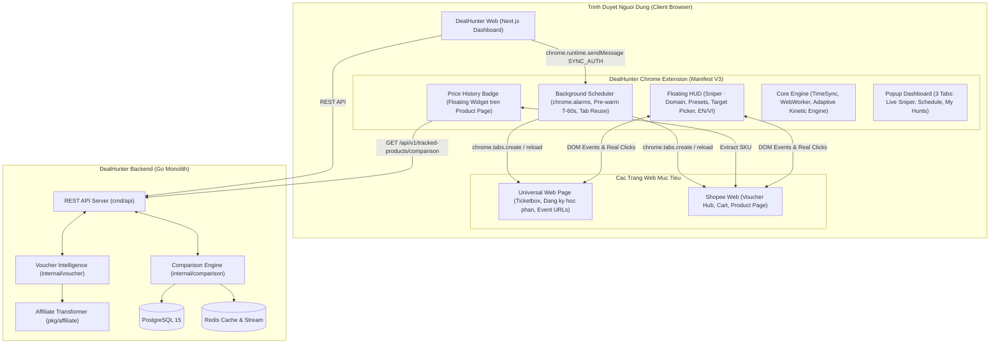

# DealHunter — Ke Hoach & Thiet Ke Ky Thuat Chrome Extension Assistant
# (Universal Fast Clicker, Multi-Platform Voucher Sniper & Price Intelligence)

> **Muc tieu tai lieu**: Dac ta vi tri kien truc, mo hinh du lieu, co che tuong tac API giua **Backend DealHunter** va **DealHunter Chrome Extension (Client-Side Assistant)**; mo ta toan dien nang luc **Universal Fast Clicker & Sniper tren moi trang web**, co che san voucher va bao toan hoa hong Affiliate da san TMDT.
>
> Cap nhat: 2026-10-09 · Ap dung cho ma nguon hoan thien trong `extension/src` va ban build `extension/dist`.

---

## 1. Boi Canh & Dinh Vi He Thong

### 1.1. Tu Shopee Voucher den Universal Web Sniper
Ban dau, tien ich duoc thiet ke de giai quyet bai toan san ma giam gia chop nhoang tren Shopee. Tuy nhien, qua trinh thuc te cho thay nguoi dung co nhu cau rat lon ve viec **click chinh xac vao dung thoi khac 00:00:00 hoac gio vang tren nhieu nen tang khac nhau**:
1. **San ve su kien / concert** tren cac trang ban ve (Ticketbox, Ticketmaster, v.v.): Cac su kien hot mo ban dung 00:00 hoac 12:00 thuong het ve trong 2 den 5 giay.
2. **Dang ky tin chi / hoc phan**: Cac cong dang ky cua truong dai hoc mo dung gio G, yeu cau bam nut "Dang ky" nhanh hon hang ngan sinh vien khac.
3. **Flash sale chop nhoang da san**: Ngoai Shopee, cac su kien mo ban gioi han tren Lazada, Tiki, TikTok Shop hoac cac website ban hang rieng biet.
4. **Voucher gia tri lon tren Shopee**: Cac ma giam 15% - 20%, voucher 500k - 1 trieu mo vao khung gio 0h, 9h, 12h, 15h, 18h, 21h het trong tich tac.

### 1.2. Nguyen Ly Thiet Ke Client-Side Assistant (Manifest V3)
Thay vi can thiep bang bot tu may chu backend (de bi he thong Cloudflare WAF, captcha, chan IP va khoa tai khoan F02/M04), DealHunter trien khai kien truc **Client-Side Assistant** chay truc tiep tren trinh duyet nguoi dung:
- Su dung session dang nhap chinh chu, cookie va dia chi IP hop le cua nguoi dung -> **100% an toan va khong bi coi la bot can thiep trai phep**.
- Tinh toan do lech thoi gian mili-giay giua may tinh va server (Domain Time Calibration qua tieu de `Date` va RTT).
- Web Worker High-Resolution Timer doc lap duy tri nhip tick 10ms khong bi trinh duyet Chrome bop nghet tai nguyen khi tab chay nen, co fallback an toan khi gap CSP.
- Mo phong chuoi su kien chuot nguoi that (Anti-Bot Human Clicker) voi phan bo Gauss 2 chieu tap trung trong tam nut va dong co dong hoc tu thich ung 3 pha.

---

## 2. Kien Truc Tong The He Thong



---

## 3. Cac Tinh Nang Va Luong Nghiep Vu Chinh

### 3.1. Universal Live Sniper (Ban Tia Truc Tiep Tren Moi Trang Web)
- **Pham vi**: Ap dung tren moi trang web HTTP/HTTPS (`<all_urls>`).
- **Nhan dien tu dong**: Khi mo Popup, he thong tu dong phat hien domain hien tai (vi du: `ticketbox.vn active`, `shopee.vn active`) va hien nut noi bat:
  `START SNIPER ON THIS PAGE` / `BAT DAU SAN TREN TRANG NAY`.
- **Bang dieu khien Floating HUD**:
  - Hien thi tieu de dong theo domain: `DealHunter · Sniper · <domain>`.
  - Cac moc gio truc chien:
    + `+10s`: San sau 10 giay de test nhanh.
    + `+30s`: San sau 30 giay.
    + `00:00`: Canh nua dem dung 00:00:00.000.
    + `+1m` / `+1p`: Canh dau phut ke tiep.
    + `Custom` / `Tuy chinh`: Nhap gio bat ky theo dinh dang `HH:mm:ss`.
  - **Khoa nut muc tieu (Target Picker)**:
    + Nut `Pick button` (`Chon nut`): Ho tro re chuot va khoa **bat ky nut nao tren DOM** cua bat ky website nao (ke ca khi nut dang bi disabled/mo truoc gio G).
    + Nut `Auto-detect` (`Tu quet`): Quet nhanh nut Luu voucher Shopee.
    + Nut `X`: Xoa muc tieu da khoa va huy bo toan bo class highlight.
  - **Phat hoa luc (Arming & Firing)**:
    + Khi bam `Arm sniper`, he thong vao trang thai truc chien dem nguoc miligiay.
    + Dung gio G (co tinh lead 150ms truoc de bu do tre mang), dong co san adaptive kich hoat va ban loat click vao nut da khoa cho den khi trang xac nhan thanh cong.

### 3.2. Full-Auto Schedule Voi Custom Link (Hen Gio Tu Dong 100%)
- **Pham vi**: Nguoi dung co the dat lich cho **bat ky duong link web nao** qua 3 che do muc tieu:
  1. `Current tab` (Tab hien tai): Su dung link cua tab dang mo.
  2. `Saved list` (Danh sach da luu): Chon tu cac nut muc tieu da khoa truoc do tu Floating HUD.
  3. `Custom link` (Link tuy chinh): Nhap duong dan web bat ky (kiem tra scheme HTTP/HTTPS an toan) kem nut `Open page and pick` de mo tab va bat che do chon nut truc quan.
- **Quy trinh hen gio**:
  1. Mo popup -> The `Schedule`.
  2. Nhap gio chay `HH:mm:ss` hoac bam phim tat flash sale (`00:00`, `09:00`, `12:00`, `15:00`, `18:00`, `21:00`).
  3. Chon che do muc tieu (`Current tab`, `Saved list`, `Custom link`).
  4. Bam `Schedule hunt` de Service Worker dang ky `chrome.alarms`.
- **Quy trinh thuc thi ngam**:
  1. **Truoc gio G 60 giay (Pre-warm T-60s)**: Service Worker danh thuc, tai su dung tab hop le (`isSamePageUrl`) hoac mo tab moi, tai moi trang va can chinh lai gio may chu.
  2. **Tab tai xong**: Content script tu dong cuon man hinh toi vi tri nut muc tieu va cho gio G.
  3. **Dung gio G**: Tu dong kich hoat chuoi burst click va ghi lai ket qua vao the `My Hunts`.

### 3.3. In-Page Price Intelligence (Theo Doi & So Sanh Gia Xuyen San)
- Khi nguoi dung xem san pham tren Shopee (`shopee.vn/product/...` hoac `shopee.vn/*-i.*.*`), component `PriceHistoryBadge` kiem tra voi Backend DealHunter:
  - Hien thi gia DealHunter ghi nhan va thong bao so sanh neu san khac (Lazada / TikTok Shop) co gia tot hon.
  - Cung cap lien ket chuyen huong truc tiep ve Web App de xem bieu do bien dong gia chi tiet.

---

## 4. Chi Tiet Kien Truc Ma Nguon Extension

Ma nguon extension tai `extension/src` duoc to chuc theo module ro rang:

```text
extension/
├── public/
│   ├── manifest.json            # Manifest V3 (<all_urls>, scripting, storage, alarms, externally_connectable)
│   └── icons/                   # Logo DealHunter cac kich thuoc 16, 24, 32, 48, 128, 512
├── src/
│   ├── background/
│   │   ├── index.ts             # Service Worker khoi tao, dieu phoi message an toan
│   │   ├── scheduler.ts         # chrome.alarms quan ly lich hen, pre-warm tab T-60s, isSamePageUrl
│   │   ├── time_calibrator.ts   # Can chinh do lech gio theo domain qua HTTP HEAD Date & RTT
│   │   └── web_session.ts       # Quan ly phien dang nhap tu web DealHunter trong storage.session
│   ├── content/
│   │   ├── core/
│   │   │   ├── element_resolver.ts # Behavioral State Machine, DOM detachment, disabled mutation
│   │   │   ├── human_biometrics.ts # Thuat toan Box-Muller, Gauss 2D, Bezier Fitts, micro-pauses
│   │   │   ├── human_clicker.ts    # Chuoi W3C Pointer Events Level 3 day du kem dwell time
│   │   │   ├── hunt_coordinator.ts # SSOT quan ly phien san, dong bo HUD va Background, session recovery
│   │   │   ├── hunt_engine.ts      # Vong lap truc chien miligiay, Autonomous Adaptive Kinetic Engine
│   │   │   ├── target_diagnostics.ts # Chuan doan SPA reactive vs Static, xac dinh dualDefenseReload
│   │   │   ├── time_sync_client.ts # Client dong bo gio miligiay
│   │   │   └── timer_worker.ts     # Web Worker Ticker 10ms kem co che fallback CSP an toan
│   │   ├── ui/
│   │   │   ├── FloatingHUD.tsx     # Bang dieu khien Sniper noi tren trang
│   │   │   ├── PriceHistoryBadge.tsx # Huy hieu thong tin gia tren trang san pham
│   │   │   └── style.css           # Dinh kieu Tailwind va style co lap Shadow/In-page
│   │   └── index.tsx            # Content script entrypoint, lang nghe ACTIVATE_HUD
│   ├── popup/
│   │   ├── components/
│   │   │   ├── ScheduleForm.tsx    # Form dat lich hen (Current tab / Saved list / Custom link)
│   │   │   ├── TaskList.tsx        # Danh sach lich hen va trang thai truc quan
│   │   │   └── TimeOffsetCard.tsx  # The trang thai dong bo gio va ping RTT theo domain
│   │   ├── App.tsx              # Popup giao dien 3 the, nhan dien domain active
│   │   └── index.tsx            # Popup mount
│   └── lib/
│       ├── constants.ts         # Hang so he thong va DEALHUNTER_WEB_ORIGINS
│       ├── drop_time.ts         # Tinh toan moc gio Viet Nam (GMT+7) va parseTimeString
│       ├── i18n.ts              # Tu dien song ngu EN (mac dinh) / VI co dau
│       ├── scheduler_client.ts  # Client giao tiep voi Background Scheduler
│       ├── storage.ts           # Wrapper chrome.storage voi quan ly hang doi va don dep TTL
│       ├── url.ts               # Kiem tra URL an toan isValidHttpUrl va isSamePageUrl
│       └── types.ts             # TypeScript interfaces toan he thong
```

---

## 5. Cac Co Che Phong Ve & Chong Chan Bot (Anti-Bot Defenses)

1. **Dong co dinh hinh dong hoc tu thich ung 3 pha (Autonomous Adaptive Kinetic Engine)**:
   - **Pha 1 — But toc gio G (Clicks 1-3)**: Chu ky $\mu = 60\text{ms}, \sigma = 10\text{ms}$ (gioi han $[45\text{ms}, 80\text{ms}]$) giat deal trong cua so vang.
   - **Pha 2 — Gian nhip thich ung (Clicks 4-8)**: Chu ky $\mu = 95\text{ms}, \sigma = 16\text{ms}$ (gioi han $[70\text{ms}, 130\text{ms}]$) kem vi nghi phuc hoi co hoc $65\text{ms} \pm 15\text{ms}$ ngay truoc cu click thu 4, pha vo chu ky nhan dien bot.
   - **Pha 3 — On dinh dai han (Clicks 9+)**: Chu ky $\mu = 140\text{ms}, \sigma = 22\text{ms}$ (gioi han $[100\text{ms}, 190\text{ms}]$) kem vi nghi dinh ky moi 5 clicks.
2. **Phan bo diem cham Gauss 2 chieu (2D Bivariate Gaussian Spatial Distribution)**:
   Toa do moi cu click tap trung quanh trong tam nut voi $\mu = 0.5, \sigma = 0.10$ trong vung an toan $25\% - 75\%$, loai bo diem anh co dinh phi tu nhien.
3. **Quy dao tiep can Cubic Bezier tuan theo Dinh luat Fitts (Fitts's Law)**:
   Khong dich chuyen con tro dot ngot. He thong mo phong quy dao giam toc dan (Ease-Out) o cu click dau kem cac su kien trung gian `pointermove`/`mousemove`.
4. **Chuan hoa phan cung W3C Pointer Events Level 3**:
   Phat day du chuoi su kien chuot vat ly: `pointerId: 1`, `pointerType: "mouse"`, `isPrimary: true`, `pressure: 0.5/0.0`, `buttons: 1/0`, `button: 0`, `which: 1`, `detail: 1`.
5. **Thoi gian giu nut vat ly (Dwell Time)**:
   Phat chuoi pointer/mouse day du dam bao trinh duyet ghi nhan day du cac su kien chuot chan thuc.
6. **May trang thai hanh vi (Behavioral State Machine)**:
   Loai bo hoan toan regex van ban. Xac dinh thanh cong dua tren DOM unmount, transition disabled, text mutation va W3C ARIA contracts.

---

## 6. Quy Chuan Chat Luong & Kiem Thu

- **151/151 Unit Tests Vitest Pass (15 Suites)**:
  Bao phu toan dien Box-Muller, Bezier curve, W3C pointer events, time calibrator, drop time GMT+7, behavioral state machine, dual-defense reload, tab reload wait va url validation.
- **Zero-Emoji Policy**:
  Toan bo ma nguon, giao dien nguoi dung (UI) va tai lieu he thong tuan thu tuyet doi 100% quy chuan Zero-Emoji.
- **Song ngu chuan muc**:
  Giao dien tieng Anh mac dinh toan cau kem tieng Viet co dau chuan xac 100%, dong bo giua Popup va Floating HUD.
